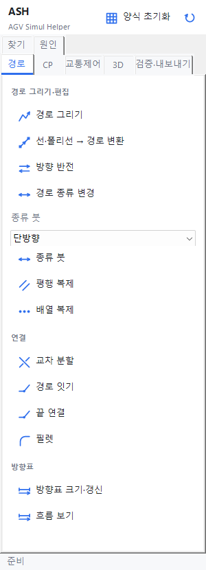
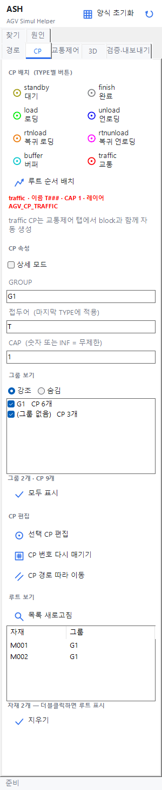
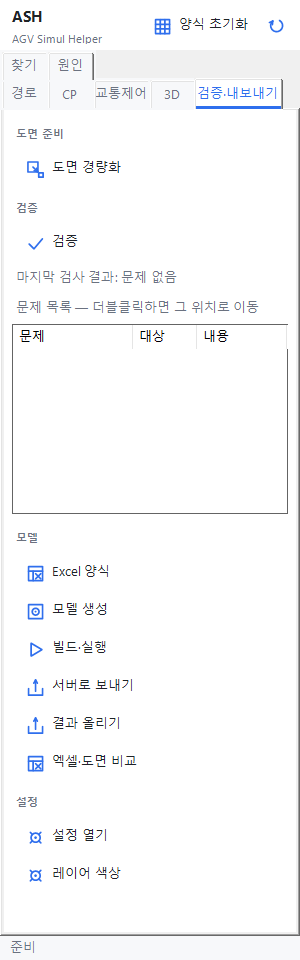
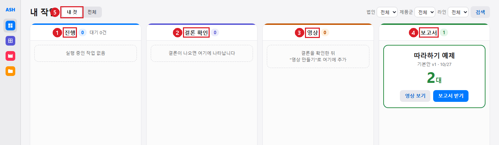
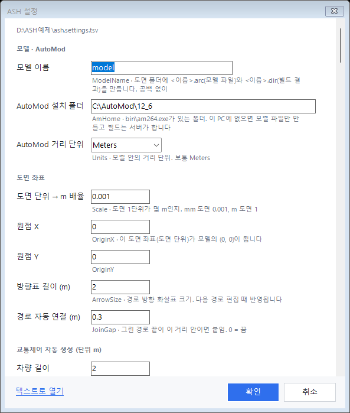

# 1. 시작하기

## 1.1 ASH가 하는 일

```
ZWCAD 도면 ──▶ input.xlsx ──▶ 모델 생성 ──▶ 서버로 보내기 ──▶ 서버(AutoMod) 대수 탐색 ──▶ 웹에서 결론 확인
(경로·CP·block)  (차량·자재·루트)  AGVMODEL       AGVSEND             그룹별 최소 대수             결론·원인·비교·영상
```

| 누가 | 무엇을 |
|---|---|
| 사용자 PC (ZWCAD + ASH 플러그인) | 경로·CP·block을 그리고, 엑셀 입력을 채우고, 모델 파일을 만들어 서버로 보낸다 |
| 서버 PC (ASH.Server + AutoMod) | 모델을 빌드하고, 대수를 바꿔 가며 돌려 그룹별 최소 대수를 찾는다 |
| 브라우저 | `http://<서버>:8082/` 에서 결론·원인·비교·영상·보고서를 본다 |

사용자 PC에 AutoMod가 없어도 된다. 빌드와 실행은 서버가 한다.

## 1.2 설치

1. `ASH-Setup-x.y.z.exe`를 받아 실행한다(관리자 권한 필요).
2. 찾은 ZWCAD가 선택된 채 나온다. 못 찾으면 "직접 지정…"으로 `ZWCAD.exe` 폴더를 고른다.
3. 서버 주소를 아는 경우 설치 때 넣는다: `ASH-Setup-x.y.z.exe /server:http://<서버>:8082`.
4. "설치"를 누른다. ZWCAD를 완전히 종료한 뒤 다시 시작한다.
5. 리본에 `ASH` 탭이 생긴다. 안 보이면 명령줄에 `AGVRIBBON` 또는 `AGVPALETTE`.

| 알아 둘 것 | 내용 |
|---|---|
| 지원 버전 | ZWCAD 2026만 |
| ZWCAD 실행 중 | 설치·제거를 하지 않는다("ZWCAD를 닫고 다시 실행하세요.") |
| SmartScreen | 서명 안 된 exe라 막히면 "추가 정보 → 실행" |
| 제거 | 같은 exe에 `/uninstall`. exe를 보관해 둔다 |
| 권한 없는 PC | IT가 `/silent /server:http://<서버>:8082`로 배포 |

## 1.3 서버 주소와 업데이트

| 하고 싶은 것 | 방법 |
|---|---|
| 서버 주소 넣기·바꾸기 | 명령 `AGVSERVER`, 또는 팔레트 검증·내보내기 탭 "설정 열기" 맨 아래 "서버 주소" |
| 새 버전 알림 | ZWCAD 시작 때 서버에 묻고 명령줄에 한 줄로 알린다 |
| 업데이트 | 팔레트 오른쪽 위 ↻ 아이콘(`AGVUPDATE`). 설치 파일을 받아 폴더를 열어 준다. ZWCAD를 완전히 끈 뒤 실행한다 |
| 공지 | ZWCAD 시작 때 새 공지를 알린다. 팔레트 오른쪽 위 종 아이콘(`AGVNOTICE`)으로 언제든 다시 본다. 안 읽은 공지가 있으면 아이콘에 빨간 점 |

업데이트는 github.com에 HTTPS로 접속할 수 있어야 한다. 막히면 [6. 문제 해결](06-faq.md).

공지는 서버에서 관리자가 승인한 것만 온다. ZWCAD를 시작하면 이 PC 버전보다 새로운 버전의 변경 내용과 일반 공지를 서버에 한 번 묻는다. 중요한 공지가 있으면 "ASH 공지" 창이 뜨고, 건너뛴 버전의 변경 내용이 새 버전부터 차례로 한 번에 보인다. 창의 "확인"은 읽은 것으로 표시(다시 안 뜸), "나중에"는 닫기만(다음 시작에 다시 뜸), "지금 업데이트"는 새 버전이 있을 때 `AGVUPDATE`를 실행한다. 중요하지 않은 공지는 창 없이 명령줄과 팔레트 상태 줄에 "공지 N건 · AGVNOTICE로 보기" 한 줄만 나온다. 서버 주소가 없거나 서버가 응답하지 않으면 아무것도 나오지 않는다. `AGVNOTICE`는 읽은 것도 포함해 서버의 공지를 전부 보여 준다.

## 1.4 화면 구성 — ZWCAD

### 리본 `ASH` 탭

| 패널 | 버튼(명령) |
|---|---|
| 레이아웃 | 양식 초기화(`AGVINIT`), 팔레트(`AGVPALETTE`), 업데이트(`AGVUPDATE`), 서버 설정(`AGVSERVER`) |
| 경로 | 경로 그리기, 선→경로 변환, 방향 반전, 경로 종류, 평행 복제, 배열 복제, 교차 분할, 경로 잇기, 필렛, 방향표 크기 |
| CP | CP 배치(`AGVCP`) |
| 교통제어 | 교통제어 자동(`AGVTRAFFIC`), block 자동(`AGVBLOCKAUTO`) |
| 검증·내보내기 | 검증, Excel 양식, 모델 생성, 빌드·실행, 서버로 보내기, 결과 올리기 |

리본 화면은 캡처하지 못했다(ZWCAD 없음).

### 팔레트 (`AGVPALETTE`)

대부분의 일은 팔레트에서 한다. 위에 "양식 초기화"와 업데이트·공지 아이콘, 아래에 상태 줄이 있다. 탭은 7개다.

| 탭 | 하는 일 | 자세히 |
|---|---|---|
| 경로 | 경로 그리기·편집·연결, 종류 붓, 흐름 보기 | [3.1](03-drawing.md#31-경로) |
| CP | TYPE별 CP 배치, 루트 순서 배치, 그룹 보기, CP 편집, 루트 보기 | [3.2](03-drawing.md#32-cp) |
| 교통제어 | block 자동 생성, 블록 채번, 교통제어 자동 생성 | [3.3](03-drawing.md#33-교통제어-block) |
| 3D | 3D 블록 배치, 벽·펜스·컨베이어 그리기, 소비 지점 | [3.4](03-drawing.md#34-3d와-컨베이어) |
| 검증·내보내기 | 도면 경량화, 검증, Excel 양식, 모델 생성, 서버로 보내기, 설정 | [3.5](03-drawing.md#35-검증-agvcheck), [4장](04-input-model.md) |
| 찾기 | 도면의 경로·CP·block 목록과 검색, 더블클릭으로 이동 | [3.6](03-drawing.md#36-찾기) |
| 원인 | 서버 원인 분석을 도면에 표시 | [3.8](03-drawing.md#38-원인-표시-agvcause) |

| 경로 | CP | 검증·내보내기 |
|---|---|---|
|  |  |  |

*실제 컨트롤(빌드한 플러그인을 ZWCAD 밖에서 그림). 목록 내용은 따라하기 예제 값.*

팔레트 버튼은 명령을 실행할 뿐이다. 다른 명령이 입력을 기다리는 중에 누르면 "실행 중인 명령을 먼저 끝내세요."가 나온다. 상태 줄에는 마지막 명령의 결과(예: "AGVTRAFFIC 완료")가 나온다.

## 1.5 화면 구성 — 웹

브라우저로 `http://<서버>:8082/`를 연다. 왼쪽 사이드바는 아이콘만 보이고 마우스를 올리면 펼쳐진다.

| 사이드바 | 화면 |
|---|---|
| 홈 | 진행 · 결론 확인 · 영상 · 보고서 네 구획 |
| 분석 | 분석 목록과 결론·비교·원인·영상·버전 탭 |
| 영상 | 영상 목록과 진행 |
| 보관함 | 보낸 파일 찾기, `continue.zip`으로 이어서 작업 |
| 종 · 자물쇠 | 알림, 관리(관리자 암호) |



*실제 화면. ① 진행 ② 결론 확인 ③ 영상 ④ 보고서 ⑤ 내 것 | 전체.*

## 1.6 처음 한 번 할 일

1. 도면을 저장한다. 저장 안 한 도면에서는 대부분의 명령이 "도면을 먼저 저장하세요"로 멈춘다.
2. 팔레트 "양식 초기화"(`AGVINIT`)로 ASH 레이어와 블록을 만든다.
3. 검증·내보내기 탭 "설정 열기"에서 배율(`Scale`)을 확인한다. mm 도면은 `0.001`, m 도면은 `1`. 설정 파일 `ash.settings.tsv`는 처음 쓸 때 도면 단위(INSUNITS)를 보고 저절로 만들어진다(단위 없음 = mm).



*실제 컨트롤. 값은 기본값.*

## 1.7 일하는 순서 한눈에

| 순서 | 팔레트 | 명령 |
|---|---|---|
| 1 경로 | 경로 탭 "경로 그리기" | `AGVPATH` |
| 2 CP | CP 탭 TYPE 버튼 | `AGVCP` |
| 3 교통제어 | 교통제어 탭 "교통제어 자동 생성" | `AGVTRAFFIC` |
| 4 검증 | 검증·내보내기 탭 "검증" | `AGVCHECK` |
| 5 입력 | "Excel 양식" | `AGVEXCEL` |
| 6 모델 | "모델 생성" | `AGVMODEL` |
| 7 보내기 | "서버로 보내기"(모델 생성 끝에 바로 묻는다) | `AGVSEND` |
| 8 결과 | 브라우저의 작업·분석 화면 | — |

처음이면 [2. 따라하기](02-tutorial.md)를 그대로 해 본다.
