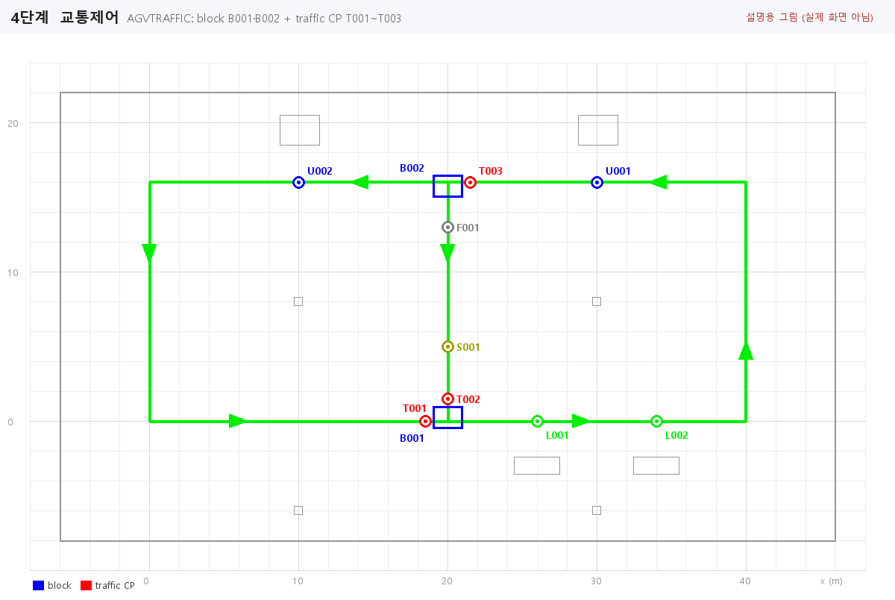
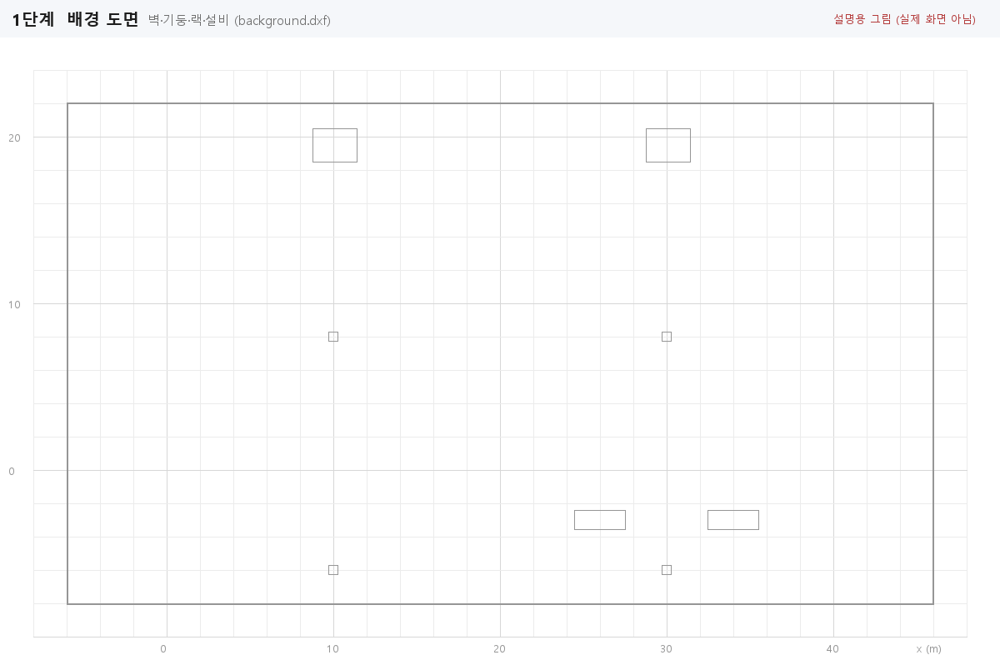
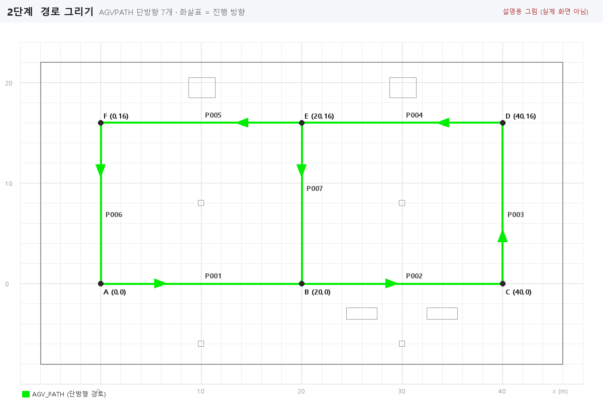
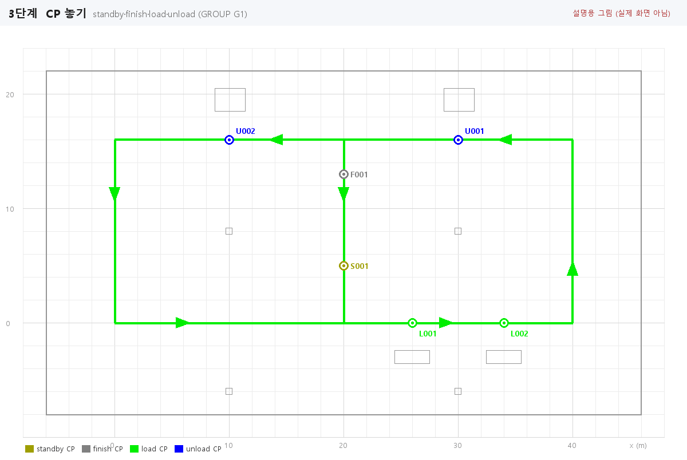
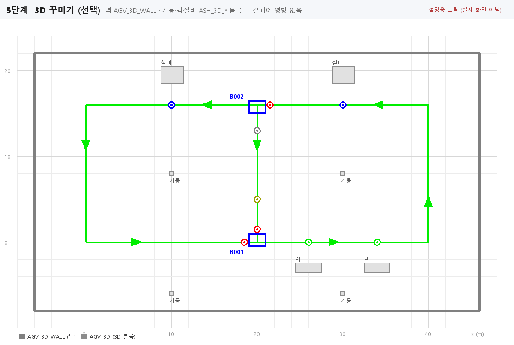
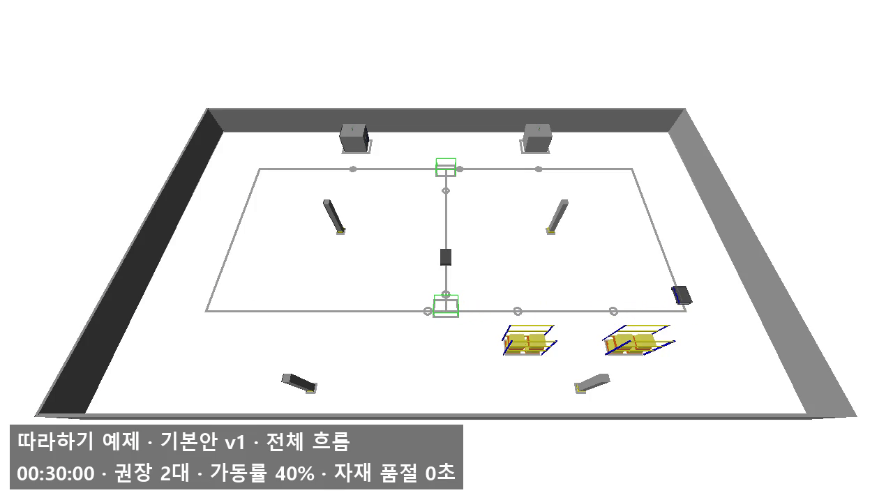
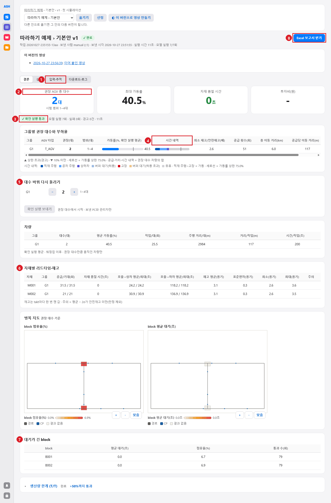

# 2. 따라하기: 첫 시뮬레이션

작은 공장 하나를 처음부터 끝까지 만든다. 한 시간 안에 끝나고, AutoMod 체험판(엔티티 200개 제한)에서도 빌드된다.

## 2.1 만들 것

| 항목 | 내용 |
|---|---|
| 경로 | 40 × 16 m 사각 순환로(단방향, 시계 반대 방향) + 가운데 세로 지름길 1개 = 경로 7개 |
| CP | 대기(standby) 1, 완료(finish) 1, 로딩(load) 2, 언로딩(unload) 2 — 모두 그룹 `G1` |
| 교통제어 | 지름길이 갈라지는 곳과 합쳐지는 곳에 block 2개, traffic CP 3개(자동) |
| 차량 | 그룹 `G1` 하나, 1~4대 중에서 찾기 |
| 자재 | `M001`(L001 → U001), `M002`(L002 → U002) |
| 3D (선택) | 벽, 기둥 4, 랙 2, 설비 2. 결과에는 영향 없음 |

차량은 지름길의 대기 CP `S001`에서 출발해 아래 길로 합류하고, 창고 쪽(아래) 로딩 CP에서 싣고, 오른쪽으로 올라가 라인 쪽(위) 언로딩 CP에 내린 뒤, 지름길로 돌아온다. `M002`는 왼쪽 끝 `U002`에 내리므로 한 바퀴를 더 돈다.

*설명용 그림. 이 장을 다 하면 도면이 이렇게 된다(3D 제외).*

## 2.2 준비

| 할 일 | 방법 |
|---|---|
| 폴더 | 새 폴더를 하나 만든다. 예: `D:\ASH예제` |
| 배경 도면 | ZWCAD로 [example/background.dxf](example/background.dxf)를 열고 그 폴더에 `example.dwg`로 저장한다 |
| 서버 주소 | `AGVSERVER`로 넣어 둔다(예: `http://ash-server:8082`). 없으면 7단계에서 보내지 못한다 |
| 좌표 입력 | 동적 입력(F12)을 끄고 좌표를 명령줄에 친다. 켜져 있으면 두 번째 점부터 상대 좌표로 들어갈 수 있다 |

배경 도면은 mm 단위다. 아래 좌표표는 m와 mm를 함께 적었다. **ZWCAD에는 mm 값을 친다.**

## 2.3 1단계 — 초기화와 설정

1. 팔레트 "양식 초기화"(`AGVINIT`)를 누른다. ASH 레이어(`AGV_PATH`, `AGV_CP_*`, `AGV_BLOCK` …)와 블록이 생긴다.
2. 검증·내보내기 탭 "설정 열기"를 누른다. 배율이 `0.001`인지 본다(mm 도면). 다른 값이면 `0.001`로 고치고 확인.
3. 나머지 설정은 기본값 그대로 둔다(차량 길이 2 m, 폭 1 m, 안전 거리 0.5 m, 경로 자동 연결 0.3 m, 모델 이름 `model`).

*설명용 그림. 배경 도면: 벽(−6,−8)~(46,22) m, 기둥 4개, 랙 2개(아래), 설비 2개(위).*

## 2.4 2단계 — 경로 7개 그리기

경로 탭 "경로 그리기"(`AGVPATH`)를 7번 한다. 매번 이렇게 한다.

1. "경로 그리기"를 누른다.
2. `경로 종류 [단방향(O)/양방향(T)/지선(S)/크랩(C)] <단방향>` → Enter(단방향).
3. 시작점을 치고 Enter, 끝점을 치고 Enter, 한 번 더 Enter로 끝낸다.

| 순서 | 이름(자동) | 시작 (m) | 끝 (m) | ZWCAD 입력 (mm) |
|---|---|---|---|---|
| 1 | P001 | A (0, 0) | B (20, 0) | `0,0` → `20000,0` |
| 2 | P002 | B (20, 0) | C (40, 0) | `20000,0` → `40000,0` |
| 3 | P003 | C (40, 0) | D (40, 16) | `40000,0` → `40000,16000` |
| 4 | P004 | D (40, 16) | E (20, 16) | `40000,16000` → `20000,16000` |
| 5 | P005 | E (20, 16) | F (0, 16) | `20000,16000` → `0,16000` |
| 6 | P006 | F (0, 16) | A (0, 0) | `0,16000` → `0,0` |
| 7 | P007 | E (20, 16) | B (20, 0) | `20000,16000` → `20000,0` |

**그리는 방향이 진행 방향이다.** 순서를 바꾸면 이름이 바뀐다(동작에는 상관없다).

이렇게 보여야 함:

- 명령줄에 `경로 P001 추가 (단방향).` 같은 줄이 경로마다 나온다.
- 중간에는 아직 이어지지 않은 끝에 빨간 원이 생기고 상태 줄에 "끊긴 끝 n개"가 나온다. 7개를 다 그리면 "끊긴 끝 없음"이 되고 원이 사라진다. **(미확인: ZWCAD에서 이 순서로 확인하지 않았다)**
- 경로 탭 "흐름 보기"(`AGVFLOW`)를 누르면 화살표가 약 5초 동안 진행 방향으로 움직인다. 아래 그림의 화살표 방향과 같은지 본다.

*설명용 그림. 초록 선 = `AGV_PATH`(단방향), 삼각형 = 진행 방향.*

## 2.5 3단계 — CP 6개 놓기

1. CP 탭의 GROUP 칸이 `G1`인지 본다(기본값).
2. 아래 표 순서대로 TYPE 버튼을 누르고, 좌표를 친 뒤 Enter로 끝낸다. 버튼 하나에 CP 여러 개를 이어 놓을 수 있다(로딩 2개는 "load" 한 번에 두 점).

| 순서 | 버튼 | 이름(자동) | 위치 (m) | ZWCAD 입력 (mm) | 놓이는 경로 |
|---|---|---|---|---|---|
| 1 | standby 대기 | S001 | (20, 5) | `20000,5000` | P007 |
| 2 | finish 완료 | F001 | (20, 13) | `20000,13000` | P007 |
| 3 | load 로딩 | L001 | (26, 0) | `26000,0` | P002 |
| 4 | (이어서) | L002 | (34, 0) | `34000,0` | P002 |
| 5 | unload 언로딩 | U001 | (30, 16) | `30000,16000` | P004 |
| 6 | (이어서) | U002 | (10, 16) | `10000,16000` | P005 |

- L001을 L002보다, U001을 U002보다 먼저 놓는다. 5단계 엑셀 양식이 놓은 순서대로 짝을 짓는다(L001↔U001, L002↔U002).
- 경로에서 0.05 m보다 먼 곳을 찍으면 "경로에서 너무 멉니다 (허용 0.05 m)."가 나오고 다시 묻는다.
- F001은 대기 레인 입구다. 가동 시간은 대기 CP에서 탄 순간부터 F001 도착까지로 센다.

이렇게 보여야 함: 루트 탭 "그룹 보기"에 `G1 CP 6개`.

*설명용 그림. 색은 CP 레이어 기본 색(standby 노랑, finish 회색, load 초록, unload 파랑).*

## 2.6 4단계 — 교통제어 자동 생성

교통제어 탭 "교통제어 자동 생성"(`AGVTRAFFIC`)을 누른다. 질문 없이 끝난다.

이렇게 보여야 함(이 결과는 ASH.Core의 같은 계산으로 확인했다):

| 만들어지는 것 | 이름 | 위치 (m) |
|---|---|---|
| block (합류) | B001 | (19, −0.5) ~ (21, 1.0) |
| block (분기) | B002 | (19, 15) ~ (21, 16.5) |
| traffic CP | T001 | (18.5, 0) — P001에서 B001 앞 |
| traffic CP | T002 | (20, 1.5) — P007에서 B001 앞 |
| traffic CP | T003 | (21.5, 16) — P004에서 B002 앞 |

명령줄: `block 2개 생성: B001, B002.`, `traffic CP 3개 생성: T001, T002, T003.`

*설명용 그림. 파란 사각형 = block, 빨간 원 = traffic CP.*

## 2.7 5단계 — 검증

검증·내보내기 탭 "검증"(`AGVCHECK`)을 누른다.

이렇게 보여야 함: 탭에 "마지막 검사 결과: 문제 없음", 명령줄 `검사 결과 0건`. 같은 배치를 ASH.Core 검사기(`LayoutChecker`)로 돌려 0건을 확인했다.

문제가 나오면 목록의 행을 더블클릭해 그 자리로 가서 고친다. 흔한 원인: 좌표 오타(끊긴 끝), 경로를 거꾸로 그림(방향 반전 `AGVREVERSE`).

## 2.8 6단계 (선택) — 3D 꾸미기

결과 숫자는 바뀌지 않는다. AutoMod 화면과 영상에만 보인다. 건너뛰어도 된다.

| 넣을 것 | 팔레트 3D 탭 | 위치 (mm) |
|---|---|---|
| 벽 | "벽"(두께 0.2) → 네 모서리 클릭 후 `C`(닫기) | `-6000,-8000` → `46000,-8000` → `46000,22000` → `-6000,22000` |
| 기둥 ×4 | 종류 "기둥" → "배치", 회전 0 | `10000,8000`, `30000,8000`, `10000,-6000`, `30000,-6000` |
| 랙 ×2 | 종류 "랙" → "배치", 회전 0 | `26000,-3000`, `34000,-3000` |
| 설비 ×2 | 종류 "설비" → "배치", 회전 0 | `30000,19500`, `10000,19500` |

벽은 배경의 `A-WALL` 선 4개를 골라 레이어를 `AGV_3D_WALL`로 바꿔도 된다(선은 두께 0.2 m 벽이 된다).

*설명용 그림.*

*실제 화면. 서버가 AutoView로 찍은 이 예제의 영상 한 장면(벽·기둥·랙·설비, block은 초록 외곽선).*

## 2.9 7단계 — 엑셀 입력

검증·내보내기 탭 "Excel 양식"(`AGVEXCEL`)을 누른다. 도면 폴더에 `input.xlsx`가 생기고 Excel로 열린다. 도면에서 읽은 이름은 이미 들어 있다.

| 시트 | 이미 채워진 것 |
|---|---|
| AGV_Types | 타입 `T_AGV` 한 행(예시 숫자) |
| AGV_Groups | 그룹 `G1`, 타입 `T_AGV`, StandbyCPs `S001` |
| Materials | `M001`, `M002`(그룹 G1, 예시 숫자) |
| Routes | `M001`: L001 → U001, `M002`: L002 → U002 |

아래 칸만 고친다(나머지는 그대로). 다 고친 파일이 [example/input.xlsx](example/input.xlsx)다. 그 파일을 도면 폴더에 복사해 써도 된다.

| 시트 | 행 | 열 | 값 | 양식 기본값 |
|---|---|---|---|---|
| Settings | SimLength | Value | `4` | 8 |
| Settings | Warmup | Value | `0.5` | 1 |
| Settings | Replications | Value | `2` | 3 |
| AGV_Types | T_AGV | SpeedEmpty | `1.2` | 1.0 |
| AGV_Types | T_AGV | LoadTime / UnloadTime | `15` / `15` | 20 / 20 |
| AGV_Types | T_AGV | Length / Width | `1.5` / `1.0` | 1.2 / 0.8 |
| AGV_Groups | G1 | MaxCount | `4` | 3 |
| AGV_Groups | G1 | FinishCP | `F001` (드롭다운) | 빈칸 |
| Materials | M001 | TaktTime | `40` | 60 |
| Materials | M001, M002 | CallThreshold | `3` | 4 |
| Materials | M001, M002 | InitStock / SafetyStock | `5` / `1` | 빈칸 / 빈칸 |
| Materials | M001, M002 | Station | `조립1`, `조립2` (메모, 선택) | 빈칸 |

그대로 두는 값: SpeedLoaded 1.0, Accel·Decel 0.3, Capacity 1, MTBF·MTTR 0, MinCount 1, Dispatch Nearest, M002 TaktTime 60, UnitsPerCycle 1, UnitsPerContainer 10, UnloadThreshold 1, Form Box, Flow Supply, Use Y, ExtraTime 0, BufferWaitSec 0.

저장한다. 이 입력은 ASH.Core 검증(`InputValidator`)에서 오류·경고 0건이다. 문제가 있는 칸은 다음 단계에서 빨강(오류)·주황(경고)으로 칠해지고 메모가 달린다.

## 2.10 8단계 — 모델 생성과 서버로 보내기

1. 검증·내보내기 탭 "모델 생성"(`AGVMODEL`)을 누른다.
2. 명령줄에 `arc: D:\ASH예제\model.arc`와 "모델 파일을 만들었습니다…"가 나온다.
3. 이어서 "ASH 서버로 보내기" 창이 뜬다(서버 주소가 있을 때). 나중에 보내려면 취소하고 "서버로 보내기"(`AGVSEND`)를 누른다. 새 서버는 `AGVSEND`만으로 충분하다(모델은 서버가 만든다, [4.6](04-input-model.md#46-서버로-보내기-agvsend)).

*실제 컨트롤. 분석 이름은 폴더 이름, 안 이름은 도면 이름이 기본값이다.*

| 칸 | 넣을 값 |
|---|---|
| 분석 | "새 분석…" → `따라하기 예제` |
| 안 | "새 안…" → `기본안` |
| 메모 (선택) | `첫 시뮬레이션` |

"보내기"를 누른다. 도면에 저장 안 한 변경이 있으면 저장할지 묻는다. 끝나면 명령줄에 `전송 완료: 작업 <번호> (앞에 n건) · v1`이 나오고 브라우저에 작업 화면이 열린다.

(이 설명서의 결과는 ZWCAD 없이 같은 배치·입력을 ASH.Core로 만들고 `AGVSEND`와 같은 방식(`JobPackage` + `JobServerClient`)으로 보내 얻었다. 창과 명령줄 문구는 코드 기준이다.)

서버는 받은 모델을 빌드하고 대수를 바꿔 가며 돌린다. 이 예제는 실행 7회였고, 테스트 서버에서 11초 걸렸다. 서버가 바쁘면 앞 작업이 끝날 때까지 기다린다.

## 2.11 9단계 — 결과 확인

작업 화면이 "완료"가 되면 결론을 본다.

*실제 화면(따라하기 예제, 기본안 v1). ① 탭 ② 권장 대수 ③ 판정 ④ 시간 내역 ⑤ 대수 바꿔 다시 돌리기 ⑥ 자재별 리드타임·재고 ⑦ 대기가 긴 block ⑧ Excel 보고서 받기.*

### 기대 결과

이 브랜치 빌드의 서버(AutoMod 14.5 체험판, `C:\AutoMod\12_6`)에서 실제로 나온 값이다. 같은 입력이면 대수는 같아야 하고, 소수점 값은 AutoMod 버전에 따라 조금 다를 수 있다.

| 항목 | 값 |
|---|---|
| 권장 AGV 총 대수 | **2대** (시험 범위 1~4대) |
| 판정 | ✓ 확인 실행 통과 · 모델 실행 7회 · 실패 0 · 경고 0 |
| 최대 가동률 | 40.5 % (상한 75 %) |
| 자재 품절 시간 | 0초 |
| 공급 횟수 | 51회 (M001 31.5 / 기대 31.5, M002 21 / 21) |
| 차량 | 작업 25.5회/대, 주행 2,984 m/대, 117 m/작업, 200초/작업 |
| 재고 | 평균 3.1 용기, 최소 2.6 용기(안전재고 1의 2.6배) |
| block | B001 점유 6.7 %, B002 6.9 %, 평균 대기 0.0초, 통과 79회 |
| 생산량 한계 (T/T) | +50 %까지 통과 |

1대면 왜 안 되는가: "대수 바꿔 다시 돌리기"에서 1대로 확인 실행하면 가동률 81.5 %로 상한 75 %를 넘는다(경고).

## 2.12 더 해 보기

같은 분석에 아래를 더하면 결론·비교·원인 탭이 채워진다. 이 설명서의 웹 그림은 모두 이 넷으로 찍었다. B안·C안 도면은 이 설명서를 만들 때 ZWCAD 대신 코드로 같은 배치를 만들어 보냈다.

| 해 볼 것 | 방법 | 실제 결과 |
|---|---|---|
| 1대로 확인 | 작업 화면 "대수 바꿔 다시 돌리기" → G1 `1` → "확인 실행 보내기" | 기본안 v2: 1대, 가동률 81.5 %, 경고(가동률 초과) |
| B안 | ZWCAD `MOVE`로 `U002`를 `10000,16000` → `26000,16000`으로 옮김 → 모델 생성 → 보내기, 안 "새 안…" `B안` | 1대, 가동률 59 %. 결론 카드에 "B안보다 1대 많음" |
| 문제 예 | `MOVE`로 `L001`을 (21.8, 0) = `21800,0`으로, 기둥 하나를 `37000,900`에 추가 → 안 `C안(문제 예)` | 2대. 원인 탭에 "P002 간격 0.6 m", "B001 늦은 해제" |
| 영상 | 분석 화면 "영상 만들기"에서 컷을 만들고 내보내기([5.6](05-results.md#56-영상)) | 30초 MP4 (컷 1개, 4배속). 이 설명서의 영상은 같은 요청을 API로 보내 만들었다 |

결과 화면 읽는 법은 [5. 결과 보기](05-results.md).
