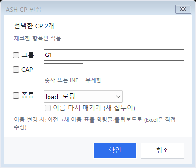
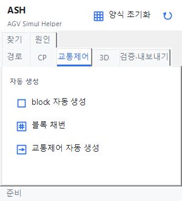
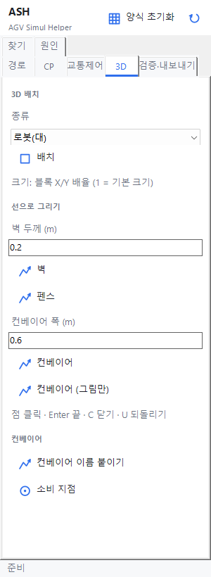
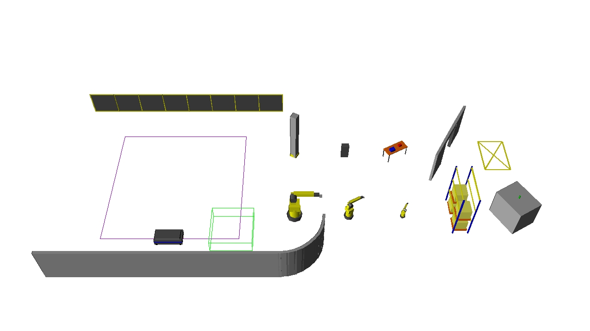
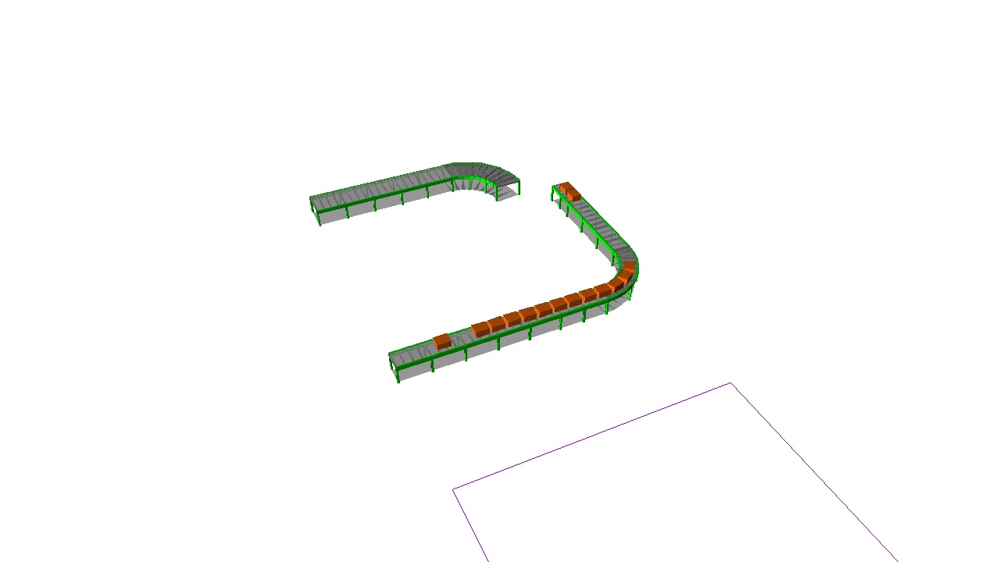
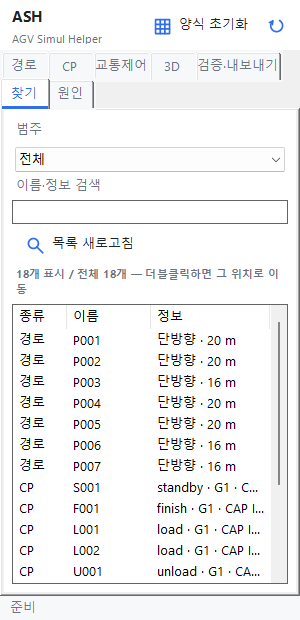
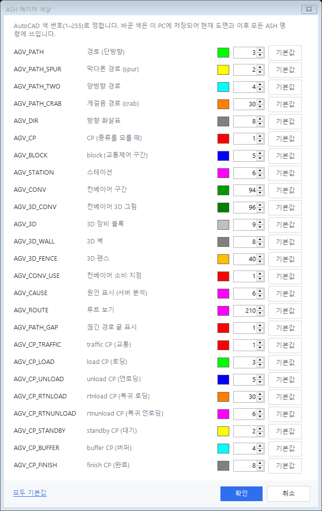
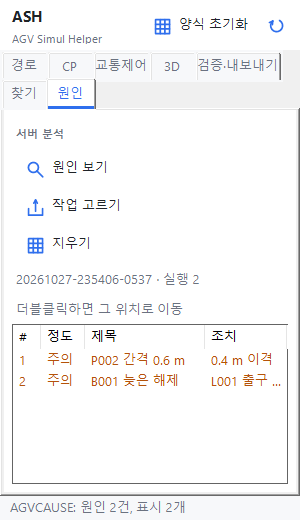
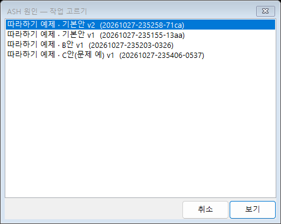

# 3. 기능 참조 — 도면 (ZWCAD)

팔레트 버튼 이름과 명령을 함께 적었다. 명령은 명령줄에 쳐도 같다. 경로를 먼저 골라 두고 실행하면 선택 질문을 건너뛰는 명령이 많다(방향 반전, 경로 종류 변경, 교차 분할, 배열 복제, 평행 복제, 필렛, 경로 잇기).

## 3.1 경로

*실제 컨트롤.*

### 그리기·편집

| 버튼 | 명령 | 하는 일 |
|---|---|---|
| 경로 그리기 | `AGVPATH` | 종류를 묻고(`단방향(O)/양방향(T)/지선(S)/크랩(C)`, Enter = 단방향) PLINE으로 그린다. 직선 구간마다 경로 하나(`P001`, `P002` …). 그린 방향 = 진행 방향 |
| 선·폴리선 → 경로 변환 | `AGVCONVERT` | 일반 선·폴리선을 경로로 바꾸고 교차점을 나눈다. `선택(S)` 또는 `레이어(L)`(한 레이어 전부) |
| 경로 정리 | `AGVTIDY` | 그린 선·폴리선을 한 번에 정리한다: 경로로 변환 → 끝 연결 → 교차 분할 → 검사. 선택하거나, Enter를 눌러 고른 객체의 레이어 전부. 마지막 줄에 `변환 N · 분할 N · 연결 N · 오류 N`. Esc면 아무 일도 없다. 모양은 그대로이고 필렛은 하지 않는다 |
| 방향 반전 | `AGVREVERSE` | 진행 방향을 뒤집는다 |
| 경로 종류 변경 | `AGVPTYPE` | 단방향·양방향·spur(막다른 길)·crab(게걸음)으로 바꾼다. 속성 창에서 레이어만 바꾸면 종류가 안 바뀐다 |
| 종류 붓 | `AGVPBRUSH` | 목록에서 종류를 고르고 버튼 → 경로를 차례로 클릭할 때마다 그 종류로. Enter로 끝 |
| 평행 복제 | `AGVOFFSET` | 기준점 → 변위 → 방향을 뒤집을지. 찍은 쪽에 새 경로 |
| 배열 복제 | `AGVARRAY` | 같은 간격으로 여러 개 복제 |

| 종류 | 레이어 | 기본 색 | 화살표 |
|---|---|---|---|
| 단방향 | `AGV_PATH` | 3 초록 | 한쪽 화살표 |
| 양방향 | `AGV_PATH_TWO` | 4 하늘 | 양쪽 화살표 |
| spur | `AGV_PATH_SPUR` | 2 노랑 | 머리에 막대 |
| crab | `AGV_PATH_CRAB` | 30 주황 | 몸통에 가로 눈금 |

### 연결

| 버튼 | 명령 | 하는 일 |
|---|---|---|
| 교차 분할 | `AGVSPLIT` | 교차점에서 경로를 나눈다(`P001_1`, `P001_2`). 분할 안 된 교차는 검증이 알려 준다 |
| 경로 잇기 | `AGVJOIN` | 이어진 경로 둘을 하나로 |
| 끝 연결 | `AGVCONNECT` | 가까운 끝끼리 붙인다. Enter = 전체, `S` = 선택 |
| 필렛 | `AGVFILLET` | 모서리를 원호로. 반경은 마지막 값을 기억한다 |

- **자동 연결**: 경로 명령이 끝점을 다른 경로 끝·중간에서 0.3 m(설정 "경로 자동 연결") 안이면 붙인다. 중간에 붙으면 그 경로를 둘로 나눈다. 명령줄에 `연결: …`.
- **끊긴 끝 표시**: 경로 명령 뒤 아무 데도 닿지 않은 끝에 빨간 원(`AGV_PATH_GAP` 레이어). 단방향 두 경로가 한 점으로 모이기만 하면 주황 원("흐름 막힘"). 상태 줄에 "끊긴 끝 n개". spur 끝, 양방향 경로의 자유 끝은 표시하지 않는다.
- 되돌리기: Ctrl+Z 한 번에 그 명령(그리기 + 연결 + 분할)이 통째로 돌아간다. `AGVTIDY`도 같다.

### 경로 정리 (`AGVTIDY`)

CAD로 그린 선을 처음 경로로 만들 때 `AGVCONVERT` → `AGVCONNECT` → `AGVSPLIT` → `AGVCHECK`를 따로 하지 않고 한 번에 한다.

1. 선·폴리선을 고른다. 먼저 골라 두고 실행해도 된다. 아무것도 안 고르고 Enter를 누르면 객체 하나를 찍어, 그 객체의 레이어 전부를 대상으로 한다.
2. 단방향 경로로 바꾸고(`AGVCONVERT`와 같다), 끝이 `JoinGap`(기본 0.3 m) 안이면 이어 붙이고, 교차점에서 나눈다.
3. 검사 결과를 `AGVCHECK`처럼 보여 준다(명령줄, 검증 탭의 문제 표). 이름 정리·분할 질문은 하지 않는다.
4. 요약 한 줄: `변환 N · 분할 N · 연결 N · 오류 N`. 오류는 모델을 만들기 전에 "계속할까요?"를 묻게 하는 문제(끊긴 끝, 나뉘지 않은 교차, 이름 중복·오류, 경로에서 벗어난 CP)의 수다.

이미 경로인 객체와 `AGV_` 레이어의 객체는 건너뛴다(건너뛴 이유는 명령줄에 나온다). 바꿀 것이 없으면 도면은 그대로다. 되돌리기는 Ctrl+Z 한 번.

### 방향표

| 버튼 | 명령 | 하는 일 |
|---|---|---|
| 방향표 크기·갱신 | `AGVARROW` | 화살표 길이(기본 2 m)를 바꾸고 다시 그린다. Enter만 누르면 다시 그리기만 |
| 흐름 보기 | `AGVFLOW` | 작은 화살표가 약 5초 동안 경로를 따라 움직인다. 도면에 남지 않는다 |

## 3.2 CP

CP(Control Point)는 차량이 서거나 판단하는 점이다. 경로 위(0.05 m 안)에만 놓인다.

| TYPE | 뜻 | 이름 | 레이어 / 기본 색 | CAP |
|---|---|---|---|---|
| standby | 대기 | S### | `AGV_CP_STANDBY` / 2 노랑 | INF |
| finish | 작업 완료 | F### | `AGV_CP_FINISH` / 8 회색 | INF |
| load | 로딩 | L### | `AGV_CP_LOAD` / 3 초록 | INF |
| unload | 언로딩 | U### | `AGV_CP_UNLOAD` / 5 파랑 | INF |
| rtnload | 복귀 로딩(빈 용기 상차) | RL### | `AGV_CP_RTNLOAD` / 30 주황 | INF |
| rtnunload | 복귀 언로딩(빈 용기 하차) | RU### | `AGV_CP_RTNUNLOAD` / 6 자홍 | INF |
| buffer | 버퍼 | B### | `AGV_CP_BUFFER` / 4 하늘 | INF |
| traffic | 교통(block 앞) | T### | `AGV_CP_TRAFFIC` / 1 빨강 | INF |

CAP을 1로 바꾼 traffic CP는 `AGV_CP_TRAFFIC_CAP1` 레이어(200 보라)로 옮겨 따로 보인다. 색은 AGVLAYERCOLOR에서 바꾼다.

### 놓기

| 기능 | 팔레트 | 명령 | 사용법 |
|---|---|---|---|
| TYPE별 배치 | CP 탭 TYPE 버튼 8개 | `AGVCP` | 버튼 → 경로 위를 클릭(또는 좌표 입력) → 계속 클릭 → Enter |
| 루트 순서 배치 | "루트 순서 배치" | `AGVCPROUTE` | 그룹을 묻고 standby → load → unload → rtnload → rtnunload → finish 순서로 단계별 배치. 클릭 = 놓기, Enter = 다음 단계, `S` = 건너뛰기, Esc = 끝 |

- **CP 속성** 칸: GROUP(기본 `G1`), 접두어(마지막 TYPE에 적용), CAP(숫자 또는 `INF`). "상세 모드"를 켜면 클릭마다 NAME·TYPE·GROUP·CAP을 묻는다.
- traffic CP는 보통 손으로 놓지 않는다. 교통제어 탭이 block과 함께 만든다.
- 루트 순서 배치로 놓은 CP는 같은 루트 번호가 남아, `AGVEXCEL`이 그 루트대로 자재·Routes 행을 만든다([4.2](04-input-model.md#42-도면으로-채우기-agvexcel)).

### 그룹 보기 (`AGVCPVIEW`)

루트 탭 "그룹 보기" 목록에 그룹마다 CP 수가 나온다. 체크한 그룹은 그대로, 나머지는 "강조"(회색) 또는 "숨김". "모두 표시"로 되돌린다. 숨겨도 검증·모델에는 들어간다(`AGVMODEL`, `AGVSEND`가 "숨긴 CP N개 포함"을 알린다).

### CP 편집

| 버튼 | 명령 | 하는 일 |
|---|---|---|
| 선택 CP 편집 | `AGVCPEDIT` | 고른 CP들의 그룹·CAP·종류를 한꺼번에 바꾼다. 종류를 바꿀 때 "이름 다시 매기기" 가능 |
| CP 번호 다시 매기기 | `AGVCPRENUM` | 종류별로 경로 진행 순서대로 `L001`, `L002` …. 이전 → 새 이름 표가 클립보드에 들어간다 |
| CP 경로 따라 이동 | `AGVCPMOVE` | CP를 고르고 커서를 움직이면 경로 위를 따라간다. 클릭 = 그 자리 |

*실제 컨트롤. load CP 2개를 고른 경우.*

이름을 바꾸면 엑셀(`input.xlsx`)의 CP 이름은 바뀌지 않는다. 클립보드 표로 엑셀을 직접 고친다.

### 루트 보기 (`AGVROUTE`)

루트 탭 "루트 보기": "목록 새로고침" → 엑셀의 자재 목록. 자재를 더블클릭하면 그 자재의 CP와 구간별 최단 경로를 `AGV_ROUTE` 레이어에 굵은 선으로 그린다(공급 = 레이어 색, 회송 = 주황, 대기 진입·복귀 = 회색, 구간 거리 글자, CP 순서 번호). 갈 수 없는 구간은 빨간 직선과 "도달 불가". "지우기"로 지운다.

## 3.3 교통제어 (block)

block은 한 번에 정해진 대수(CAP, 기본 1)만 들어가는 구역이다. 교차·분기·합류에 둔다.

*실제 컨트롤.*

| 버튼 | 명령 | 하는 일 |
|---|---|---|
| block 자동 생성 | `AGVBLOCKAUTO` | 경로가 갈라지거나 합쳐지는 점(분기·합류·교차)마다 block 사각형(`AGV_BLOCK`)을 만든다 |
| 블록 채번 | `AGVBLOCKNUM` | `AGV_BLOCK` 레이어의 닫힌 사각형을 원점(0,0)에서 가까운 순으로 `B001`부터. 태그 없는 손그림 사각형에는 태그를 붙인다 |
| 교통제어 자동 생성 | `AGVTRAFFIC` | block 자동 생성 + block 앞 진입 경로에 traffic CP |

- 크기: 교차점에서 각 가지로 차량 폭/2 + 안전 거리까지(설정 `VehicleWidth`, `SafetyGap`, `BlockReach`). 따라하기 예제에서는 2 × 1.5 m.
- 교차점 둘이 차 한 대 설 자리보다 가까우면 "B001, B002 가까워 합칠까요? [Y/N]"를 묻는다. 합친 사각형 안에 정차 CP(load·standby 등)가 들어가면 "(정차 CP … 교착 위험)"이 붙고 기본값이 N이다.
- 다시 실행해도 이미 block이 있는 점은 건너뛴다.
- block 안에 정차 CP가 들어가면 "B001 안에 정차 CP …: 거기 선 차량이 block을 계속 잡아 교착됩니다" 경고가 나온다. CP를 block 밖으로 옮긴다.
- 교차점 바로 뒤 짧은 구간(차 한 대 + 안전 거리보다 짧음)은 block에 통째로 넣는다.

## 3.4 3D와 컨베이어

3D는 그림이다. AutoMod 3D 창과 영상에만 나오고 결과 숫자에는 영향이 없다. 컨베이어(`AGV_CONV` + 엑셀 `Conveyors` 행)는 예외로, 자재 소비 방식을 바꾼다.

*실제 컨트롤.*

| 기능 | 팔레트 3D 탭 | 명령 | 사용법 |
|---|---|---|---|
| 3D 블록 | 종류 → "배치" | `AGV3D` | 위치 클릭 → 회전 각도. 크기는 블록 X/Y 배율(1 = 기본 크기). 종류: 로봇(대)·로봇(중)·로봇(소)·랙·설비·기둥·충전기·작업대·출입문·바닥 표시 |
| 벽 | "벽" | `AGV3DLINE` | 점 클릭, Enter 끝, `C` 닫기, `U` 되돌리기. `AGV_3D_WALL` 폴리선, 두께 = "벽 두께 (m)"(기본 0.2), 높이 3 m |
| 펜스 | "펜스" | `AGV3DLINE` | `AGV_3D_FENCE`, 높이 2 m, 기둥 2 m 간격 |
| 컨베이어 | "컨베이어" | `AGV3DLINE` | `AGV_CONV` 폴리선, 폭 = "컨베이어 폭 (m)"(기본 0.6). 끝나면 `CV001` 이름이 붙는다. 그린 방향 = 흐름 |
| 컨베이어 그림 | "컨베이어 (그림만)" | `AGV3DLINE` | `AGV_3D_CONV`. 모양만, 제품 흐름 없음 |
| 이름 붙이기 | "컨베이어 이름 붙이기" | `AGVCONV` | 직접 그린 `AGV_CONV` 폴리선에 `CV###` 이름과 글자 |
| 소비 지점 | "소비 지점" | `AGVCONVUSE` | 컨베이어 위 한 점 → 그 자리에서 자재를 소비(`AGV_CONV_USE` 막대). 엑셀 `ConsumeAt`보다 도면이 우선 |

- `AGV_3D_WALL`·`AGV_3D_FENCE` 레이어에 직접 그린 선·폴리선도 벽·펜스가 된다.
- 엑셀 `Conveyors` 시트에 행이 있는 컨베이어만 제품(주황 상자)이 `ProductTakt`마다 흐른다. 소비 지점에 재고가 없으면 멈춘다. 시트는 [4.1](04-input-model.md#41-엑셀-입력-inputxlsx).
- 체험판 AutoMod는 컨베이어 구간도 엔티티 200개 제한에 센다.

| 3D 그림 예 | 컨베이어 예 |
|---|---|
|  |  |

*실제 화면(개발 중 AutoMod에서 찍은 그림, 따라하기 예제 아님).*

## 3.5 검증 (`AGVCHECK`)

검증·내보내기 탭 "검증". 도면을 검사하고 문제를 탭의 표(문제 · 대상 · 내용)에 넣는다. 행을 더블클릭하면 그 자리로 화면이 옮겨 간다(배율 그대로). 명령줄에는 `[코드] 메시지 (x, y)`와 `검사 결과 n건`.

| 표의 "문제" | 조치 |
|---|---|
| 끝점이 이어지지 않음 | 좌표 확인, "끝 연결"(`AGVCONNECT`) |
| 들어오기만/나가기만 하는 점 | 방향이 틀린 경로를 "방향 반전" |
| 교차점이 나뉘지 않음 | "지금 분할할까요?"에 Y, 또는 "교차 분할" |
| CP가 경로에서 벗어남 | "CP 경로 따라 이동"으로 경로 위로 |
| CP 이름 중복 · CP 이름 없음 · 경로 이름 중복 · 이름이 올바르지 않음 | "경로 이름을 정리할까요?" Y, "선택 CP 편집" |
| block 이름 중복 · block이 경로에 닿지 않음 | "블록 채번", 사각형 위치 확인 |
| 정차 CP가 block 안에 있음 | CP를 block 밖으로 |
| 원인 · 간격 부족 · 교차 | 서버 원인 분석 중 도면만으로 아는 것(간격 부족, block 늦은 해제, 교착 위험, 우회). [5.3](05-results.md#53-원인) |

### 저장할 때 검증

ASH를 쓴 도면(`AGV_` 레이어가 있고 경로·CP·block이 있는 도면)을 저장하면 도면 검사를 조용히 한 번 하고 팔레트 상태 줄에 결과를 적는다.

| 상태 줄 | 뜻 |
|---|---|
| `검증: 문제 없음` | 문제가 없다 |
| `검증: 오류 2 · 경고 1 (AGVCHECK)` | 오류 = 모델을 만들기 전에 "계속할까요?"를 묻게 하는 문제. 경고 = 나머지. 자세한 내용은 `AGVCHECK` |

- 명령줄에 아무것도 쓰지 않고 화면도 옮기지 않는다. 저장은 끝난 뒤에 검사하므로 막거나 늦추지 않는다. 걸린 시간은 `plugin.log`에 `시간 저장 검증`으로 남는다.
- ASH 명령이 도는 중에는 하지 않는다. 자동 저장·DXF 저장도 건너뛴다. ASH를 쓰지 않은 도면은 읽지 않는다.
- 도면이 아주 커서 저장 뒤가 느리면 끈다. `%APPDATA%\ASH\ash.user.tsv`에 `SaveCheck`, 탭, `0`을 한 줄 적는다(줄을 지우면 다시 켜진다).
- 서버 원인 분석 행(`AGVCHECK`의 원인·간격 부족)은 저장 검증에 넣지 않는다.

## 3.6 찾기

"찾기" 탭: 범주(경로 전체, 경로 · 종류별, CP 전체, CP · TYPE별, block)와 이름·정보 검색으로 거른다. 행을 더블클릭하면 그 객체가 선택되고 화면 가운데로 온다. 처음 열 때 목록이 채워진다(`AGVFIND`). 도면을 고친 뒤에는 "목록 새로고침".

*실제 컨트롤. 목록은 따라하기 예제.*

## 3.7 도면 준비와 색

| 버튼 | 명령 | 하는 일 |
|---|---|---|
| 도면 경량화 | `AGVLITE` | 큰 공장 도면의 가벼운 사본(DXF)을 만든다. 경로를 그리거나 AutoMod 배경으로 쓴다 |
| 레이어 색상 | `AGVLAYERCOLOR` | ASH 레이어 색을 바꾼다. 이 PC에 저장되어 다른 도면에도 쓰인다. "모두 기본값"으로 되돌림 |
| 설정 열기 | — | `ash.settings.tsv` 편집 창(배율, 차량 크기, 안전 거리, 모델 이름, AutoMod 폴더, 서버 주소) |

*실제 컨트롤.*

## 3.8 원인 표시 (`AGVCAUSE`)

서버 "원인" 탭과 같은 분석을 도면에 그린다. 끝난 작업이 있어야 한다.

| 버튼 | 명령 | 하는 일 |
|---|---|---|
| 원인 보기 | `AGVCAUSE` | 마지막으로 보낸 작업(도면 폴더의 `ash.job.txt`)의 원인을 받아 `AGV_CAUSE` 레이어에 번호 원과 제목을 그린다. 목록에 번호·정도·제목·조치 |
| 작업 고르기 | `AGVCAUSEJOB` | 분석 · 안 vX 목록에서 다른 작업을 고른다 |
| 지우기 | `AGVCAUSECLEAR` | 표시를 지운다 |

목록 행을 더블클릭하면 그 표시로 확대하고 관련 경로·CP·block을 선택한다.

| 원인 탭 | 작업 고르기 |
|---|---|
|  |  |

*실제 컨트롤. 목록 내용은 실제 서버의 "C안(문제 예)" 작업 원인 2건.*

## 3.9 다음 할 일

팔레트 맨 위의 작은 목록. 도면에 아직 없는 것, 빠진 파일을 작업 순서대로 보여 준다. ASH 명령이 끝날 때마다, 도면을 저장할 때마다 갱신된다. 항목에 명령 이름이 있으면 더블클릭으로 그 명령을 실행한다. 할 일이 없으면 "할 일 없음".

| 항목 | 뜻 | 더블클릭 |
|---|---|---|
| 경로 없음 | 경로가 하나도 없다 | `AGVPATH` |
| CP 없음 | CP가 하나도 없다 | `AGVCP` |
| 그룹 G1: 대기 CP 없음 | 그 그룹에 standby·buffer CP가 없다(모델을 만들 때 멈춘다) | — |
| 그룹 G1: load 없음 | 그 그룹에 load CP가 없다 | — |
| block 없음 | 경로가 갈라지거나 모이는데 block이 하나도 없다 | `AGVTRAFFIC` |
| 도면 저장 | 도면에 이름이 없다. 설정·입력 파일은 도면 폴더에 둔다 | `QSAVE` |
| ash.settings.tsv 없음 | 도면 폴더에 설정 파일이 없다(ASH 명령을 하나 실행하면 만들어진다) | — |
| input.xlsx 없음 | 도면 폴더에 입력 양식이 없다 | `AGVEXCEL` |
| 검증 오류 N건 | 모델을 만들기 전에 "계속할까요?"를 묻게 하는 문제 N건 | `AGVCHECK` |
| 모델 없음 | input.xlsx는 있는데 `<모델 이름>.arc`가 아직 없다 | `AGVMODEL` |

- 그룹 이름은 도면의 CP에 적힌 것에 더해, `input.xlsx`가 없을 때는 `ash.settings.tsv`의 Groups에서도 가져온다. `input.xlsx`가 있으면 엑셀은 읽지 않는다(느리고 암호화된 파일일 수 있다). 엑셀에만 있는 그룹은 CP를 놓은 뒤에 나타난다.
- 그룹이 없는 CP(traffic)는 어느 그룹에도 세지 않는다.
- 도면을 바꾸지 않는 명령도 도면을 한 번 읽는다. 걸린 시간은 `plugin.log`의 `다음 할 일`.
