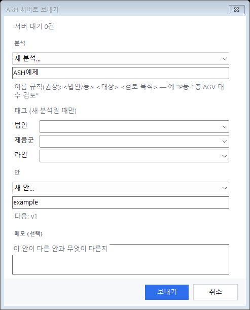

# 4. 기능 참조 — 입력과 모델

## 4.1 엑셀 입력 (`input.xlsx`)

도면 폴더의 `input.xlsx` 하나가 차량·자재·루트를 정한다. 모든 시트: 1행 머리글, 2행 설명, 3행부터 데이터. 길이·속도는 도면 단위와 상관없이 m, m/s.

| 시트 | 한 행 = | 꼭 넣을 것 |
|---|---|---|
| Settings | 설정 하나(Key / Value) | SimLength(h), Warmup(h), Replications, UtilMax(가동률 상한, 기본 0.75), SafetyStock |
| AGV_Types | 차량 제원 하나 | 속도(적재·공차), 가감속, Capacity(용기 수), LoadTime·UnloadTime(초), Length·Width(m), Kind |
| AGV_Groups | 차량 무리 하나 | Type, MinCount~MaxCount(찾을 범위), StandbyCPs, FinishCP(선택) |
| Materials | 자재 하나 | Group, TaktTime(초), UnitsPerCycle, UnitsPerContainer, CallThreshold(호출 임계), InitStock·SafetyStock |
| Routes | 자재의 운반 경로 하나 | SupplyFromCP(load) → SupplyToCP(unload), 선택: BufferCP, ReturnFromCP·ReturnToCP(빈 용기 회수) |
| Conveyors (선택) | 컨베이어 하나 | Conveyor(CAD 이름 `CV###`), Material, ProductTakt |

| 칸 색 | 뜻 |
|---|---|
| 파랑 | 머리글 |
| 회색 기울임 | 예시 행. 지우거나 덮어쓴다(두면 예시 자재가 모델에 들어간다) |
| 연녹색 | 입력이 필요 없는 칸(자동 수식, 메모) |
| 빨강 / 주황 | ASH 검증이 찾은 오류 / 경고. 칸 메모에 이유 |

열 하나하나의 뜻과 단위는 [input-template.md](../input-template.md)에 있다. 자주 쓰는 규칙:

- 호출 임계 = 용기 열 + 자재 열 ÷ 용기당 수량(옆의 "합계(자동)" 열에 보인다).
- 숫자 칸의 `-`는 빈칸과 같다(기본값).
- `Materials.Use`가 `N`인 자재는 모델·검증·결과에서 빠진다(그 자재의 Routes 행도).
- `Materials.Flow` = `Output`이면 빈 용기 공급 + 풀 용기 반출(교환). 결과의 자재 이름에 "(반출)".
- 가동 시간은 대기 CP에서 탄 순간부터 FinishCP(없으면 대기 CP) 도착까지.

## 4.2 도면으로 채우기 (`AGVEXCEL`)

검증·내보내기 탭 "Excel 양식". 도면을 저장한 뒤 쓴다.

| 상황 | 동작 |
|---|---|
| `input.xlsx`가 없음 | 도면의 CP로 채운 양식을 만들고 Excel로 연다 |
| 이미 있음 | 묻는다. `O`(기본) 열기만 · `U` 갱신 · `W` 덮어쓰기 |

| 도면 → 엑셀 | 채워지는 것 |
|---|---|
| CP의 GROUP | AGV_Groups 한 행씩(타입 `T_AGV`), StandbyCPs = 그 그룹의 standby CP |
| load CP (낱개 배치) | 자재 `M001`, `M002` …. 같은 순서의 unload·buffer·rtnload·rtnunload CP와 짝을 지어 Routes에. **짝은 추측이므로 확인한다** |
| "루트 순서 배치"로 놓은 CP | 루트마다 자재 하나(`M###`), Routes는 루트대로, FinishCP도 채움 |
| 속도·T/T 같은 숫자 | 도면에서 알 수 없어 예시 값. 꼭 고친다 |

`U` 갱신은 입력한 값을 두고 도면에서 새로 생긴 것(새 그룹, standby CP, 아직 Routes에 없는 load CP)만 뒤에 붙인다. 지운 CP·그룹은 지우지 않는다(검증이 알려 준다). `U`·`W` 모두 먼저 `input.bak.<날짜_시각>.xlsx`로 복사한다.

### 드롭다운

| 열 | 고르는 목록 |
|---|---|
| AGV_Types.Kind | Standard / Conveyor / Ant / Magnet |
| AGV_Groups.Type, Dispatch | AGV_Types의 Type / Nearest, FIFO |
| Materials.Group, Form, Flow, Use | AGV_Groups의 Group / Box, Pallet, Trolley / Supply, Output / Y, N |
| Routes.Material, Conveyors.Material | Materials의 Material |
| Routes의 CP 열, StandbyCPs, FinishCP | 도면의 CP 이름(열에 맞는 TYPE만: SupplyFromCP = load, SupplyToCP = unload …) |

CP 이름 드롭다운은 막지 않고 경고만 한다. 도면에 아직 없는 이름을 미리 적을 수 있다. StandbyCPs에 `S001,S002`처럼 쉼표 목록이 있으면 그 열에는 드롭다운을 걸지 않는다.

### 사내 문서 암호화

암호화로 파일을 직접 못 읽으면 Excel을 통해 읽고 고친다(Excel이 저장하므로 암호화가 유지된다). 읽은 값은 `input.cells.tsv`로 남아 서버로 간다. Excel에서 셀 편집 중이면 실패하니 편집을 끝내고 다시 한다.

## 4.3 엑셀·도면 비교 (`AGVEXCELDIFF`)

검증·내보내기 탭 "엑셀·도면 비교". 결과는 검증 표에 나온다(더블클릭 = 그 CP로 이동).

| 종류 | 뜻 | 등급 |
|---|---|---|
| 도면에 없음 | 엑셀이 쓰는 CP 이름이 도면에 없음 | 오류 |
| 타입 불일치 | 열과 CP TYPE이 다름(예: load CP를 SupplyToCP에) | 오류 |
| 미사용 CP | traffic이 아닌 CP를 어느 행도 안 씀 | 경고 |
| 그룹 불일치 | CP의 GROUP과 자재·그룹의 그룹이 다름 | 경고 |

## 4.4 검증 표시 (빨강·주황 칸)

`AGVEXCEL`(U·W)이 끝날 때와 `AGVMODEL`이 입력을 검사한 뒤, 문제 칸을 칠하고 메모(`ASH 검증(오류): …` / `ASH 검증(경고): …`)를 단다. 명령줄에 `Excel 표시: 오류 n건(빨강), 경고 n건(주황)`. 다음 실행 때 이전 표시를 지우고 새로 칠한다. 직접 단 메모는 지우지 않는다. 행이 없는 문제(Settings 값 등)는 명령줄에만 나온다.

주요 검사: 이름 중복, 없는 타입·그룹·자재·CP 이름, TaktTime > 0, UnitsPerContainer ≥ 1, MinCount ≥ 1, MaxCount ≥ MinCount, Warmup < SimLength, 허용 값(Dispatch, Kind, Form …), 자재 형태를 그 그룹 차량 Kind가 싣지 못함(경고).

## 4.5 모델 생성 (`AGVMODEL`)

검증·내보내기 탭 "모델 생성".

1. `input.xlsx`를 읽고 도면을 검사한다. 도면 오류가 있으면 "오류 n건이 있습니다. 계속할까요?"
2. `<도면 폴더>\model.arc`에 모델 파일을 쓴다(`agv.asy`, `model~.asy`, `model.amo`, `params.txt`, `input.sig` …). **빌드는 하지 않는다.**
3. 서버 주소가 있으면 바로 "서버로 보내기" 창을 띄운다([4.6](#46-서버로-보내기-agvsend)).

| 명령줄 메시지 | 뜻 |
|---|---|
| `arc: …\model.arc` | 모델 폴더 |
| 모델 파일을 만들었습니다… | 성공 |
| 입력 오류가 있어 모델을 만들지 않았습니다. | 엑셀 빨강 칸을 고친다 |
| `input.xlsx이 없어 경로·CP만 내보냅니다…` | 엑셀이 없다. `AGVEXCEL` 먼저 |
| 모델 생성 중단: 그룹 G1에 standby/buffer CP가 없습니다. | 그룹마다 대기 CP가 하나 이상 있어야 한다 |
| 경고: 그룹 G1: 대기 CP S001 앞에 줄 설 공간이 n m뿐입니다… | 대기 CP 앞 레인이 "최대 대수 × (차량 길이 + 0.5 m)"보다 짧다. 대기 CP를 옮기거나 MaxCount를 줄인다 |

| 다른 버튼 | 명령 | 하는 일 |
|---|---|---|
| 빌드·실행 | `AGVRUN` | 이 PC에 AutoMod가 있으면 빌드(필요할 때만) 후 AutoMod 창에서 연다. 눈으로 확인용 |
| 결과 올리기 | `AGVRESULTUP` | 이 PC에서 `ash-run`으로 돌린 결과(`runs\`)를 모델과 함께 서버에 올린다 |

`input.sig`는 입력 지문이다. 그룹·타입·자재·Routes·대기 CP·SimLength 등 모델에 굳는 값을 바꾸면 모델을 다시 만들어야 한다. T/T·임계값·재고·Warmup·반복 수는 실행마다 `params.txt`로 넘어가므로 다시 만들 필요가 없다. 그래도 헷갈리면 다시 "모델 생성".

## 4.6 서버로 보내기 (`AGVSEND`)

*실제 컨트롤.*

| 칸 | 뜻 |
|---|---|
| 서버 대기 n건 | 지금 서버 작업 대기열. 예상 시작·보통 걸리는 시간도 나온다 |
| 분석 | 같은 검토를 묶는 이름(예: "P동 1층 AGV 대수 검토"). "새 분석…"으로 만든다 |
| 태그 | 법인 · 제품군 · 라인(새 분석일 때만). 홈·분석 목록 검색에 쓴다 |
| 안 | 분석 안의 대안(기본안, B안 …). 같은 안에 다시 보내면 다음 버전(v2, v3 …) |
| 메모 (선택) | 이 안이 다른 안과 무엇이 다른지 |

**새 서버**(모델을 서버가 만드는 서버)에는 `AGVMODEL` 없이 바로 보낼 수 있다. 보내기 전에 `input.xlsx`와 도면을 읽어 입력을 검증하고, 오류가 있으면 엑셀 칸에 빨강·주황으로 표시하고 보내지 않는다. 통과하면 모델 대신 도면 정보와 엑셀 값을 보내고 서버가 모델을 만든다. 예전 서버에는 먼저 `AGVMODEL`로 모델을 만들어야 한다("보낼 파일이 없습니다" 안내가 나온다).

보내는 것: 새 서버는 `layout.tsv`(도면 정보), `input.cells.tsv`(엑셀 값), `ash.settings.tsv`; 예전 서버는 `model.arc` 전체, `input.cells.tsv`, `ash.settings.tsv`. 둘 다 도면 DXF(배경·영상용)와 저장된 DWG(100 MB 이하)가 함께 간다. 도면에 저장 안 한 변경이 있으면 "저장 후 보내기 / DWG 없이 보내기 / 취소"를 묻는다. 끝나면 작업 화면이 브라우저로 열리고, 도면 폴더의 `ash.job.txt`에 작업 번호가 남는다(`AGVCAUSE`가 쓴다).

| 서버가 하는 일 | |
|---|---|
| 빌드 | 서버의 AutoMod로 |
| 탐색 | 그룹별로 MinCount~MaxCount 사이에서 판정을 통과하는 최소 대수를 찾는다 |
| 판정 | 공정 정지(자재 품절) 0 → 최소 재고 ≥ 안전재고 → 가동률 ≤ UtilMax → 생산 달성(이론 소비량의 95 %) → 교착 0 |
| 확인 실행 | 찾은 대수로 반복 실행해 다시 판정 |

가동률 상한 초과는 실패가 아니라 경고(주황)다. 실패(빨강)는 자재 품절·생산 미달·교착·결과 없음뿐이다.

## 4.7 입력 표 (`AGVINPUT`)

Excel을 열지 않고 플러그인 안에서 `input.xlsx`를 채운다. 도면을 저장해 두고 `AGVEXCEL`로 양식을 만든 뒤 실행한다. 사내 문서 암호화로 Excel만 열 수 있는 파일도 된다.

| 칸 | 뜻 |
|---|---|
| 탭 | 자재 · 그룹 · 타입 · 컨베이어. 파일에 있는 시트만 나온다 |
| 열 | 파일 1행의 열 이름 그대로. 머리글에 마우스를 올리면 열 이름과 설명 |
| 회색 열 | 자동 계산 칸. 고칠 수 없다 |
| 드롭다운 | 형태·흐름·사용 여부 같은 목록 열, 그룹·타입·자재 이름 열, CP 열(도면에 있는 CP). 목록에 없는 값도 적을 수 있다(CP를 아직 안 그렸을 때). 대기 CP는 쉼표로 직접 적는다 |
| 고급 열 | 잘 안 쓰는 열은 숨겨져 있다. 아래 "고급 열"을 체크하면 보인다 |
| 행 추가 | 탭마다 있다. 새 행은 시트 맨 아래에 붙는다. 행 삭제는 없다(Excel에서 지운다) |
| Delete 키 | 선택한 칸을 비운다 |

| 칸 색 | 뜻 |
|---|---|
| 빨강 / 주황 | 입력 검사의 오류 / 경고. 칸에 마우스를 올리면 이유 |
| 파랑 | 저장하지 않은 변경 |

고치고 잠깐 쉬면 입력 검사(`AGVMODEL`과 같은 검사, 도면의 CP 이름 포함)가 다시 돌고, 아래 줄에 `오류 n · 경고 n · 변경 n칸`이 나온다. 줄에 마우스를 올리면 문제 목록. 숫자 칸에 글자를 적으면 `읽기 오류`가 나오고 그 칸만 빨갛게 되며, 고칠 때까지 다른 검사는 멈춘다.

**저장**은 바뀐 칸과 새 행만 파일에 쓴다. 파일의 서식·드롭다운·다른 시트는 그대로다. 저장한 뒤 파일을 다시 읽어 이후 변경은 저장본과 견준다. "닫기"에 저장하지 않은 변경이 있으면 저장할지 묻는다.

| 파일 | 읽기 | 저장 |
|---|---|---|
| 보통 파일 | 직접 읽는다 | 직접 쓴다 |
| Excel이 열어 둔 파일 | Excel의 열린 창을 읽는다(저장 안 한 변경 포함, 안내가 나온다) | 열린 창에 쓰고 저장한다 |
| 암호화된 파일 | Excel이 숨어서 한 번 읽는다(처음 몇 초) | 같은 숨은 Excel이 쓰고 저장한다. 암호화는 그대로. 창을 닫으면 Excel도 끝난다 |

표로 저장해도 `AGVMODEL`·`AGVEXCEL`이 칠한 빨강·주황 칸과 메모는 그대로 남는다. 다음 `AGVMODEL`이 새로 칠한다. 계산 칸(호출 임계 합계)은 Excel이 계산하므로 직접 읽은 파일에서는 빈칸으로 보인다.
