# 5. 기능 참조 — 결과 보기 (웹)

그림은 모두 따라하기 예제를 실제 서버에서 돌린 화면이다(분석 "따라하기 예제": 기본안 v1·v2, B안, C안(문제 예)).

## 5.1 홈

| 번호 | 구획 | 내용 |
|---|---|---|
| ① | 진행 | 실행 중·대기 중인 작업과 영상. 진행률, 끝날 시각 |
| ② | 결론 확인 | 결론이 나온 분석. "영상 만들기"로 이어진다 |
| ③ | 영상 | 만드는 중이거나 다 된 영상 |
| ④ | 보고서 | 영상까지 끝난 분석. "보고서 받기" |
| ⑤ | 내 것 · 전체 | 내 PC가 보낸 것만 / 모두. 오른쪽 위 법인·제품군·라인으로 거른다 |

내 작업이나 영상이 끝나거나 실패하면 알린다. http 주소에서는 화면 안 알림과 탭 제목 "(n)"만 된다.

## 5.2 분석 — 결론

분석 화면 위쪽 탭: **결론 · 비교 · 원인 · 영상 · 버전**. 오른쪽 위 버튼: 영상 보기 · 영상 만들기 · 보고서 받기.

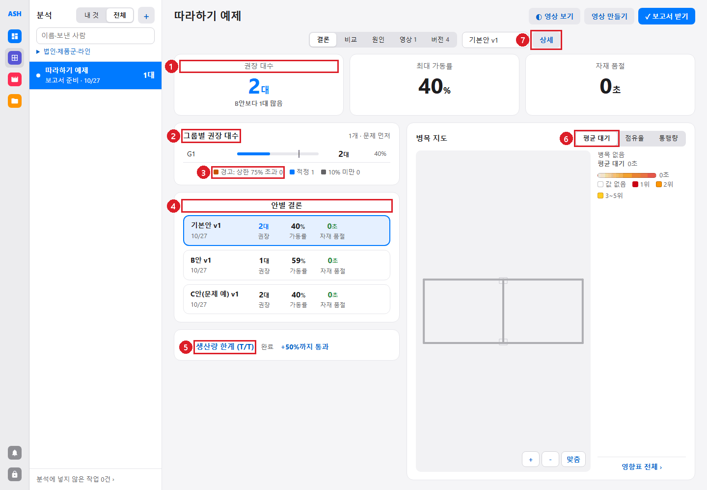

| 번호 | 무엇 | 읽는 법 |
|---|---|---|
| ① | 핵심 숫자 | 권장 대수(다른 안과의 차이), 최대 가동률, 자재 품절. 단가가 있으면 투자비 |
| ② | 그룹별 권장 대수 | 그룹마다 대수와 가동률 막대. 문제 있는 그룹이 먼저 |
| ③ | 범례 | 주황 = 경고: 상한 초과, 파랑 = 적정, 회색 = 10 % 미만 |
| ④ | 안별 결론 | 안마다 선정(또는 최신) 버전의 대수·가동률·자재 품절. 누르면 그 버전 결론 |
| ⑤ | 생산량 한계 (T/T) | 접힌 칸. [5.5](#55-생산량-한계-tt) |
| ⑥ | 병목 지도 | 평균 대기 · 점유율 · 통행량. block을 색으로, 상위 5개를 번호로. "＋ 컷"으로 그 block을 찍는 영상 컷 |
| ⑦ | 상세 | 이 버전의 작업 화면([5.7](#57-작업-화면)) |

버전 선택 상자(⑦ 왼쪽)로 다른 버전의 결론을 본다.

| 통행량 보기 |
|---|
| 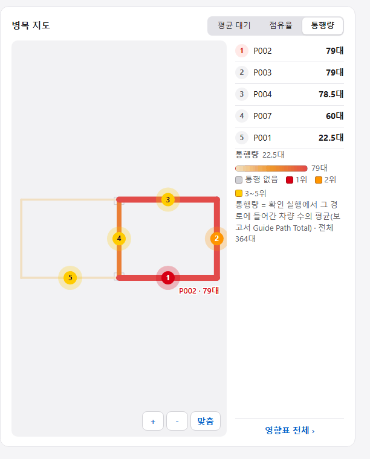 |

*경로마다 지나간 차량 수(확인 실행 평균). 가장 붐비는 경로 5개를 번호로 짚는다. 예제에서는 P002·P003 79대, P004 78.5대, P007 60대, P001 22.5대 순.*

## 5.3 원인

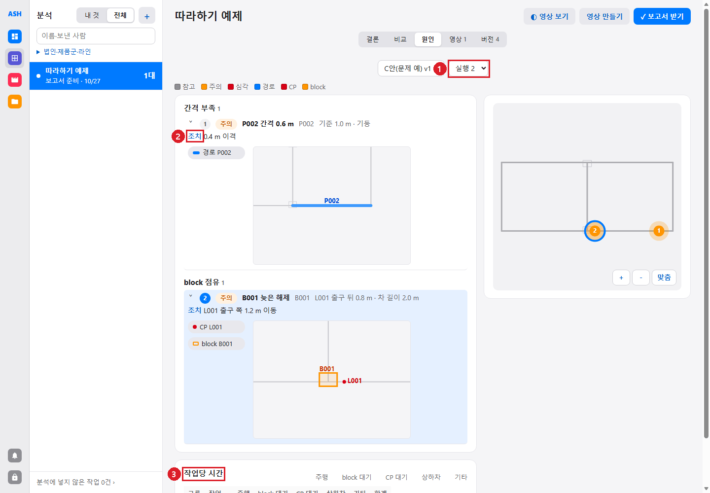

| 번호 | 무엇 |
|---|---|
| ① | 버전과 실행(시드) 고르기. 기본은 문제가 가장 큰 실행 |
| ② | 원인 항목. 정도(참고·주의·심각), 제목, 위치, 상세, **조치**. 줄을 누르면 펼쳐져 관련 경로·CP·block 그림이 나온다 |
| ③ | 작업당 시간: 한 작업이 주행 · block 대기 · CP 대기 · 상하차 · 기타에 몇 초 썼는지 |

오른쪽 지도의 번호가 항목 번호다. 시각이 있는 항목에는 "영상 컷" 버튼이 있다(그 장면 컷을 만들고 영상 만들기를 연다).

| 원인 종류 | 뜻 |
|---|---|
| 간격 부족 | 경로가 벽·기둥·설비에 차량 폭/2 + 안전 거리보다 가깝다 |
| block 점유 | block을 너무 일찍 잡거나 늦게 놓는다(예: 정차 CP가 block 출구 바로 뒤) |
| 교착 · 교착 위험 | 서로 기다리는 block 고리 |
| 우회 | 루트가 직선거리보다 훨씬 길다(끊긴 연결, 틀린 방향) |
| 주행 부하 | 수요 비율보다 주행을 훨씬 많이 차지하는 자재 |
| 시간 손실 | 대기가 순수 주행의 1.5배 이상인 그룹 |

같은 분석을 도면에 그리려면 ZWCAD 팔레트 원인 탭 "원인 보기"(`AGVCAUSE`, [3.8](03-drawing.md#38-원인-표시-agvcause)).

## 5.4 비교

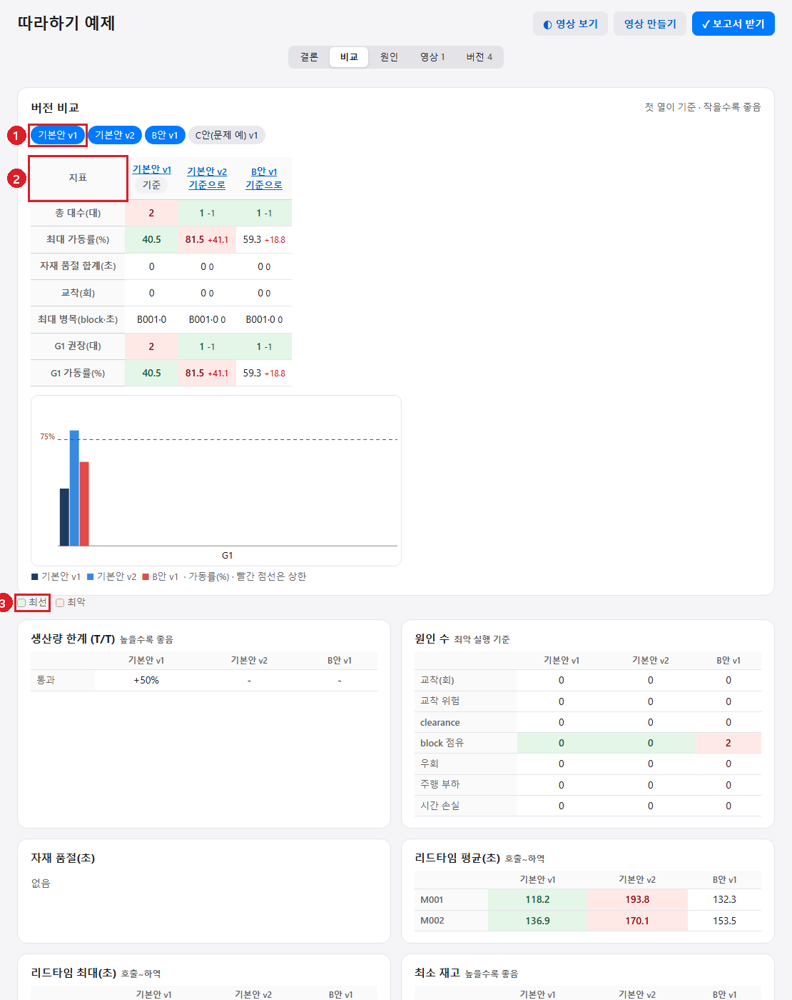

| 번호 | 무엇 |
|---|---|
| ① | 버전 칩. 누르면 넣고 뺀다. 첫 칩이 기준 |
| ② | 지표 표: 총 대수, 최대 가동률, 자재 품절 합계, 교착, 최대 병목, 그룹별 권장·가동률. 기준 대비 차이와 좋아짐(초록)·나빠짐(빨강) |
| ③ | 최선 · 최악 표시. 아래에 그룹별 가동률 막대(빨간 점선 = 상한), 생산량 한계, 원인 수, 병목 지도 비교 |

예제 값: 기본안 v1 2대 40.5 % · 기본안 v2 1대 81.5 %(+41.1) · B안 v1 1대 59.3 %(+18.8).

## 5.5 생산량 한계 (T/T)

결론이 나온 버전의 권장 대수 그대로, 모든 자재의 T/T를 줄여(생산량 +10 %, +20 % … +50 %) 다시 돌린다. 어디까지 버티는지 본다. 결론 탭 "생산량 한계 (T/T)"를 펼치고 "다시 계산"(보낸 PC와 관리자만).

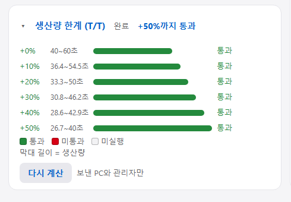

*예제: +0 %(T/T 40~60초)부터 +50 %(26.7~40초)까지 모두 통과. 막대 길이 = 생산량.*

## 5.6 영상

| 화면 | 하는 일 |
|---|---|
| 영상 만들기 (`/analyses/<id>/cuts`) | 도면 위에 구역을 그려 컷을 만든다. 종류: 구역 고정 · A → B 이동 · 전체. 시작 시각, 시뮬레이션 길이 × 배속 = 영상 길이. 시점 조정(X 기울기, Y 회전, Z 방향, 원근). 장면 후보(병목, 전체 …) "＋ 컷으로 추가" |
| 영상 탭 | 이 분석의 영상 목록 |
| 영상 화면 (`/films/<id>`) | 컷별 진행, 이어 붙인 MP4, 컷 파일 `all.zip` |

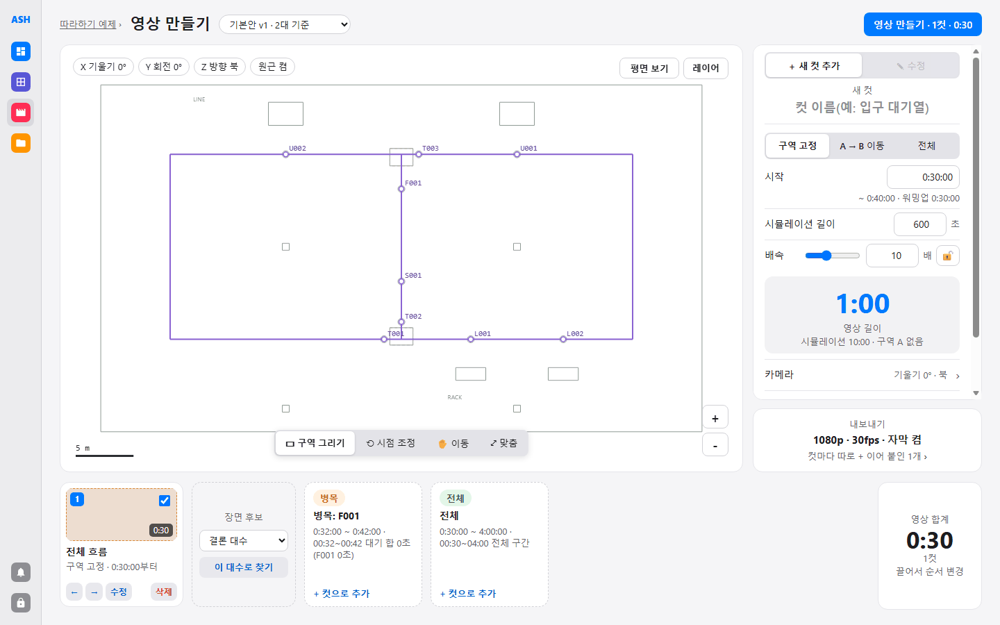

*실제 화면. 아래 왼쪽 "전체 흐름" 컷 하나(30초)가 목록에 있다.*

| 영상 탭 | 영상 화면 |
|---|---|
| 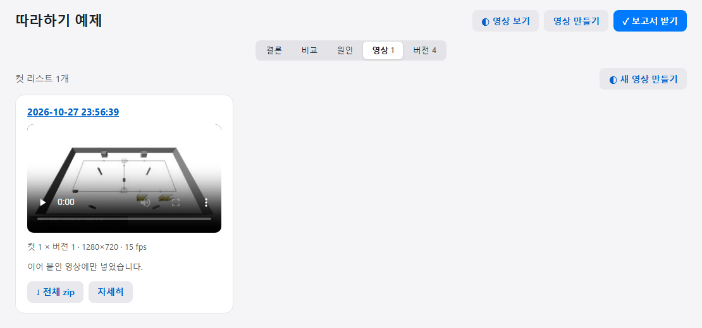 | 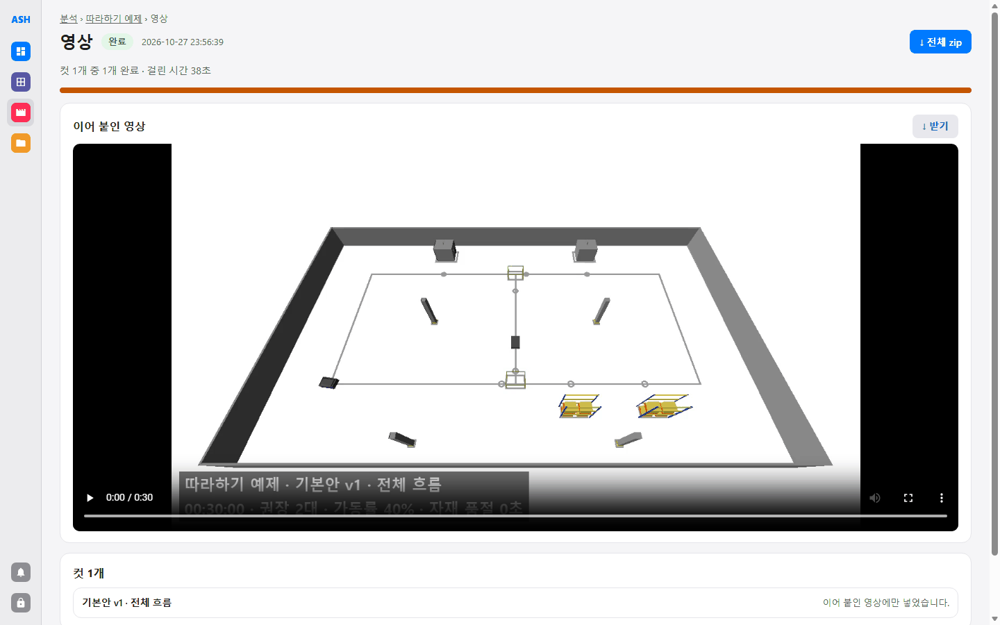 |

영상은 서버의 AutoView가 찍고 ffmpeg가 자막을 넣는다. 작업과 같은 일꾼을 쓰므로 큰 작업이 도는 동안은 뒤로 밀린다. 이 설명서의 영상은 컷 1개(전체, 4배속, 1280×720)를 API로 요청해 만들었다. 컷 편집기의 버튼을 눌러 만드는 과정은 이 설명서에서 직접 해 보지 않았다 **(미확인)**. 자세한 것은 [autoview-guide.md](../autoview-guide.md).

## 5.7 작업 화면

결론의 "상세" 또는 버전 탭 "열기". 탭: **결론 · 상세 · 입력·추적 · 다운로드·로그**.

| 번호 | 무엇 |
|---|---|
| ① | 탭 |
| ② | 권장 AGV 총 대수(시험 범위), 최대 가동률, 자재 품절 시간, 투자비 |
| ③ | 판정. ✓ 확인 실행 통과 / 경고 / 실패, 모델 실행 횟수 |
| ④ | 시간 내역 막대: 적재 주행 · 공차 주행 · 상하차 · 버퍼 대기(허용) · 고장 · 버퍼 대기(허용 초과) · 유휴. 앞의 다섯 개 합 = 가동률 |
| ⑤ | 대수 바꿔 다시 돌리기: 그룹 대수를 −/+로 바꾸고 "확인 실행 보내기". 같은 안의 새 버전이 된다(보낸 PC와 관리자만) |
| ⑥ | 자재별 리드타임·재고: 공급/기대 횟수, 자재 품절 시간, 호출→상차·하차 시간, 재고 평균·최소·최대 |
| ⑦ | 병목: block 점유율·평균 대기 지도와 "대기가 긴 block" 표 |
| ⑧ | Excel 보고서 받기 |

위쪽 줄: 다른 분석·안으로 "옮기기", 안의 대표 버전으로 "선정", "이 버전으로 영상 만들기".

### 상세

대수-가동률 곡선(그룹마다 대수별 가동률, 빨간 점선 = 상한), 차량별 표(차량마다 가동률·시간 내역·작업 수·주행 거리), 자재별 공급 빈도, 실행 목록(권장 대수 그대로 통과한 실행에 "적정", 그 시드의 모델 zip 받기).

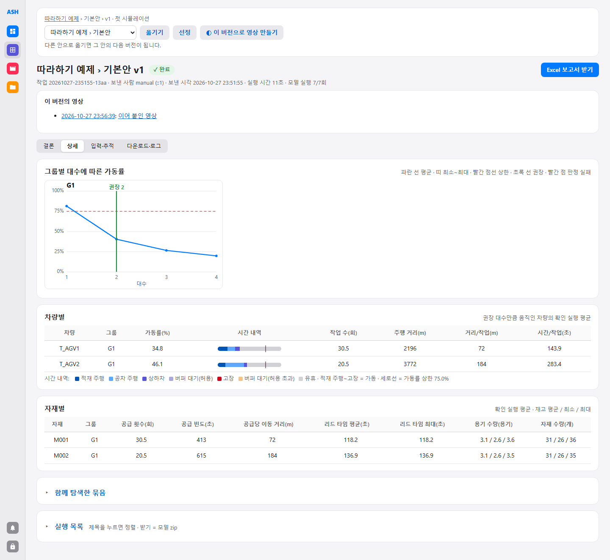

### 입력·추적

서버가 받은 입력을 그대로 보여 준다. 무엇으로 이 결과가 나왔는지 확인할 때 본다.

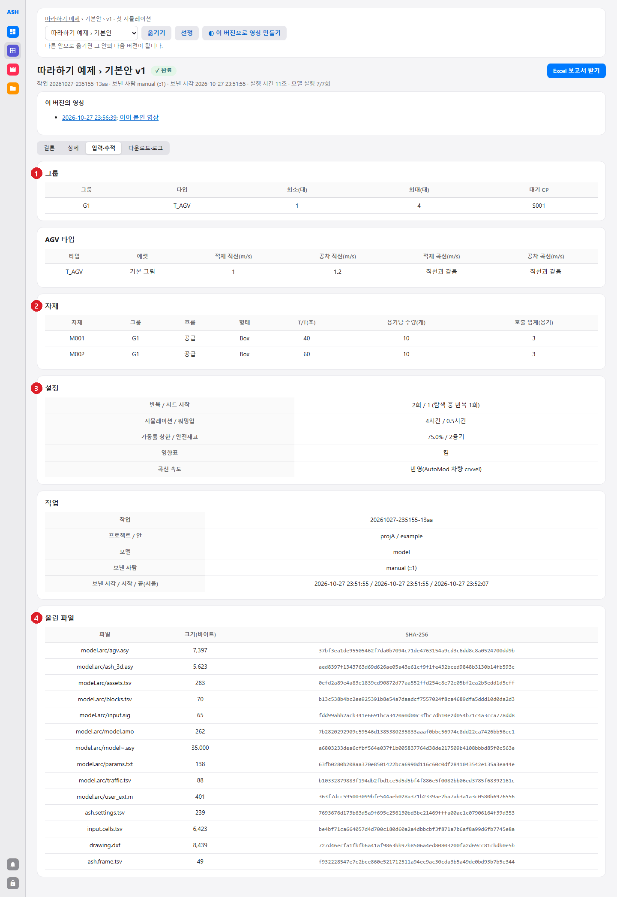

| 번호 | 무엇 |
|---|---|
| ① | 그룹(타입, 최소·최대, 대기 CP) |
| ② | AGV 타입과 자재(T/T, 용기당 수량, 호출 임계). 미사용 자재가 있으면 표 아래에 |
| ③ | 설정(반복·시드, 시뮬레이션 길이·워밍업, 가동률 상한·안전재고)과 작업 정보(보낸 사람, 시각) |
| ④ | 올린 파일: 이름, 크기, SHA-256 |

### 다운로드·로그

`report.xlsx`(Excel 보고서), `summary.tsv`(실행마다 그룹별 지표), `impact.tsv`, `runs.zip`(실행 원본), `upload.zip`(보낸 파일), `job.log`. 아래에 작업 로그.

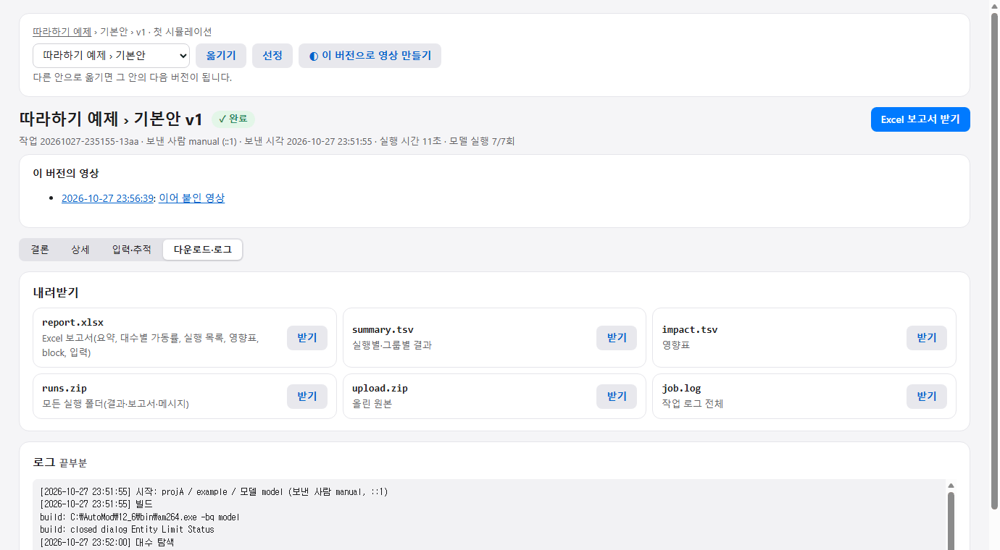

## 5.8 버전과 보고서

버전 탭: 안마다 버전 목록(대수·가동률·자재 품절·메모), "자료 받기", "선정"(그 안의 대표 버전), "열기".

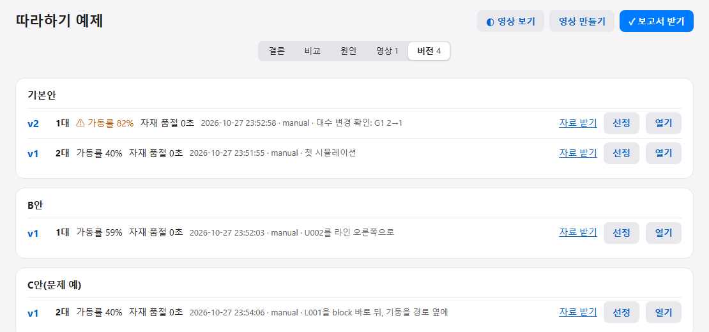

"보고서 받기"는 인쇄용 화면을 연다. "PDF로 저장"(A4 가로), PPT(차트 편집 가능), Excel을 받는다. 위쪽 목록에서 버전을 고른다.

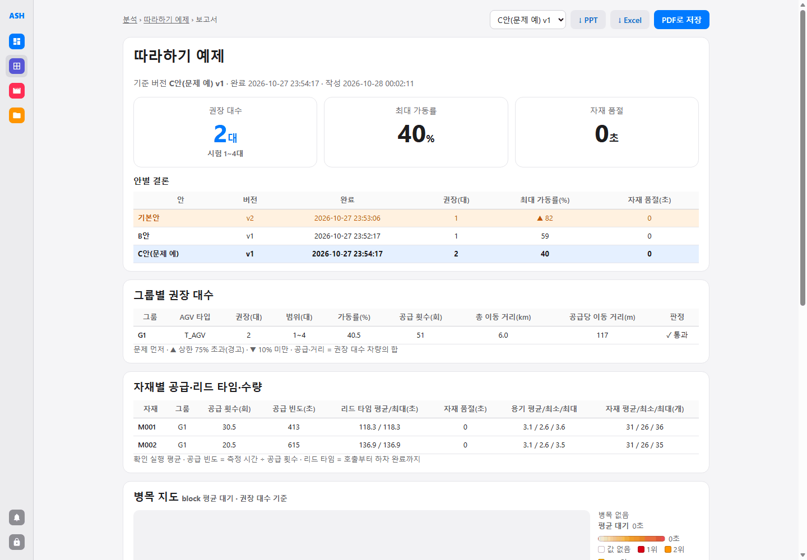
