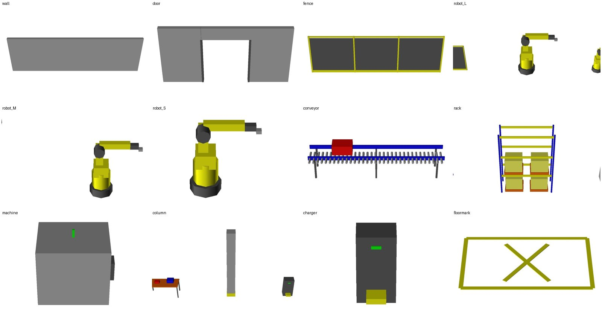
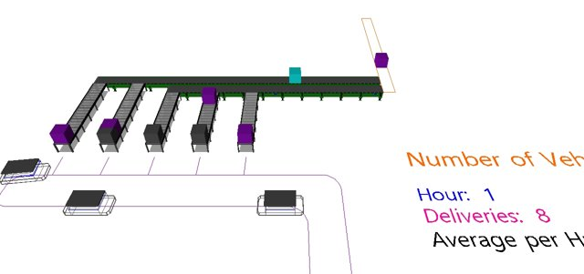
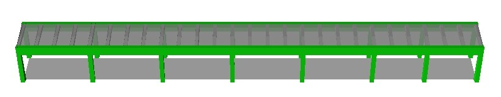

# 설계: 플러그인 CP 작업성 5건 + 시뮬레이션 3D 에셋·컨베이어 (2026-10-26)

대상 독자: 이 저장소를 처음 보는 개발자. 이 문서만으로 구현 계획을 세울 수 있도록 쓴다.
상태: 설계 검토용. 구현 전. 코드 위치는 2026-10-26 main(0.26.10) 기준.

## 0. 왜 하는가

ASH는 ZWCAD 플러그인으로 AGV 경로·CP를 그리고, 엑셀 입력과 합쳐 AutoMod 모델을 만들어 서버에서 분석·영상을 만든다.
이번 요청은 두 갈래다.

1. **CP 작업 속도와 가독성** — 그룹이 많아지면 CP가 뒤섞여 보이고, 경로 초록·대기 CP 노랑은 흰 배경에서 안 보이며, 팔레트 버튼은 작업 순서와 무관하게 늘어서 있고, 루트 하나를 그리려면 타입을 바꿔 가며 여러 번 눌러야 한다. 생산 모델이 바뀌면 자재를 지웠다 넣었다 해야 한다.
2. **시뮬레이션 3D의 생동감** — 지금 영상·3D 창에는 경로, 차량, 상자(load), 도면 2D 선만 나온다. 벽·로봇·컨베이어·펜스가 있으면 내부 검토 때 현장을 떠올리기 쉽다. 컨베이어 위로 제품이 흘러가고, 나중에 자재가 떨어지면 멈추는 것까지 보고 싶다.

3D의 용도는 **내부 검토**다. 고객 발표용 품질은 목표가 아니다. 상자·원기둥으로 알아볼 수 있는 모양이면 된다.

## 1. 범위

### 하는 것
- F1 CP 그룹별 강조·숨김
- F2 ASH 레이어 색상 변경(사용자 설정)
- F3 팔레트 CP 버튼 2열 재배열
- F4 루트 순서 배치 모드
- F5 엑셀 자재 사용/미사용
- F6 3D 에셋: CAD 블록·폴리선 → 시뮬레이션 정적 3D, 기본 에셋 묶음
- F7 컨베이어: 실제 AutoMod 컨베이어 시스템으로 제품 흐름, 자재 품절 시 정지(1단계)

### 하지 않는 것
- 웹 지도(서버 컷 편집기·병목 지도)에 3D 표시. 2D 선 배경은 지금처럼 유지.
- 외부 3D 파일(STL/OBJ/FBX)을 에셋으로 올리는 기능 확장. 지금 있는 차량 에셋 변환(`AssetConverter`)은 손대지 않는다.
- 컨베이어 분기·합류·전송(transfer), 여러 자재 혼류, 로봇 동작 애니메이션(키네마틱). 2단계 이후.
- 그룹별 레이어 분리. CP 그룹은 지금처럼 블록 어트리뷰트 `GROUP`에만 둔다.

### 실패로 치는 것
- 기존 도면·엑셀·모델이 그대로 열리지 않는 것. 새 열·새 블록이 없는 입력은 지금과 똑같이 동작해야 한다.
- 3D 에셋을 넣었더니 분석 결과(KPI·통행량)가 달라지는 것. 정적 그래픽은 시뮬레이션 로직과 무관해야 한다(컨베이어 F7은 예외: 의도된 로직).
- 숨긴 CP가 내보내기에서 빠지는 것. 숨김은 화면용이다.

## 2. 현재 구조(요약, 계획에 필요한 만큼만)

| 영역 | 위치 | 알아둘 점 |
|---|---|---|
| 팔레트 | `src/ASH.Plugin/Ui/AgvPaletteControl.cs` | 탭 5개(경로·CP·교통제어·검증·찾기). CP 탭은 `TableLayoutPanel` 2열, 순서는 `CpTypes.All` 그대로. 버튼은 `Theme.Make`, 클릭은 `AgvPalette.Send("AGVCP")`. 팔레트는 도면을 직접 만지지 않고 **항상 명령을 경유**한다. |
| CP 타입 | `src/ASH.Core/Traffic/CpTypes.cs` | `All = traffic, load, unload, rtnload, rtnunload, standby, buffer, finish`, `ColorIndex`(ACI), 접두어는 `AutoNamer`(T/L/U/RL/RU/S/B/F), 채번 `CpNaming.Next` = 최대+1, 3자리. |
| CP 생성 | `src/ASH.Plugin/Commands/CpCommands.cs` `AGVCP` | `PathCommands.Run` 안에서 `GetPoint` 루프, 경로에 스냅(`LayoutChecker.Project`, `CpMaxOffset`), `DrawingWriter.AddCp`. 타입·그룹·CAP·접두어는 `Ui/CpSettings.Current`(메모리). |
| 레이어·색 | `src/ASH.Plugin/Conventions.cs`, `Commands/InitCommands.cs` `AshLayers()`·`Init()` | 색은 하드코딩(PATH 3, SPUR 2, TWO 4, CRAB 30, DIR 8, CP 1, BLOCK 5, STATION 6, CP 타입별은 `CpTypes.ColorIndex`). `Init`은 **모든 ASH 명령 시작 때** 레이어 색을 되돌리고 블록 정의 안을 ByLayer로 만든다. |
| 팔레트 색 | `src/ASH.Plugin/Ui/Theme.cs` `CpColor` | 버튼 RGB. `finish` 항목이 빠져 있어 회색으로 나온다(버그). |
| 설정 저장 | `src/ASH.Core/Settings/UserSettings.cs`(`%APPDATA%\ASH\ash.user.tsv`, 키 `ServerUrl`·`FilletRadiusM`), `ProjectSettings.cs`(`<도면폴더>\ash.settings.tsv`) | 둘 다 TSV. `UserSettings.Save`는 아는 키만 다시 쓰므로 키를 더하면 Read·Save 둘 다 고친다. |
| 도면 읽기 | `src/ASH.Plugin/Cad/DrawingReader.cs` | 경로(AGV_PATH*), CP(블록 `AGV_CP` 어트리뷰트 NAME/TYPE/GROUP/CAP, 회전·스케일은 안 읽음), 스테이션, block. **일반 블록은 읽지 않는다.** |
| 엑셀 | `src/ASH.Core/Input/ExcelTemplate.cs`(열 정의 SSOT) · `ExcelReader.cs`(머리글 이름으로 열 찾음, 없는 선택 열은 빈 값) · `InputValidator.cs` | Materials 19열, Routes 8열. 자재당 Route 1행. `ExcelTemplate.Update`가 옛 통합 문서에 빠진 열을 뒤에 붙인다. |
| 모델 생성 | `src/ASH.Core/Model/ModelBuilder.cs` (호출은 **플러그인** `ModelCommands.cs:153`뿐) | `.arc` = `agv.asy`(AGVS) + `<모델>~.asy`(프로세스, 그래픽은 .asy 안 인라인 셀) + `model.amo` + `params.txt` + `input.sig` + `traffic.tsv` + `blocks.tsv` + `user_ext.m`. 서버는 받은 .arc를 **빌드·실행만** 한다. `MATERIALS` 인덱스 mi는 `p.Materials` 행 순서와 1:1이고 `InputSignature`에 들어간다. |
| 셀(그래픽) | `src/ASH.Core/Cel/CelWriter.cs`, `Export/VehicleGeometry.cs` | 상자 `310 5`(색 색 0 1 1 이름 / 위치 / 회전 / 배율 / `by bx ty tx h 0 0`, 피트). 원기둥은 `320 5`(`r1 r2 h 0 0`). 그룹 `700 21`(이름 / 위치 / 회전 / 배율 / 자식 수). |
| 정적 시스템 | `src/ASH.Core/Film/StaticDrawing.cs`, `docs/autoview-guide.md` §11 | 영상용 복사본에만 `ash_drw.asy`(SYSTYPE Static, HMF 선)를 넣고 `model.amo`의 PROCSYS 앞에 `STATIC name ash_drw`. 정적 .asy를 바꾸면 `<모델>.dir`을 지우고 빌드. 체험판 엔티티 수에 안 잡힘. |
| 영상 | `src/ASH.Server/FilmWorker.cs`, `Core/Film/*` | 컷마다 `aview64 -n`, 프레임 JPG → ffmpeg MP4. 장면 크기로 F0 보정(`ash_cal`). |
| AutoMod 설치(이 PC) | `C:\AutoMod\12_6\`(실제 14.5.0.4) | `demos\graphics\cell\*.cel`(사람·팔레트·지게차 등 24개), `demos\graphics\kinematic\fanuc\rbt_*.cel`(FANUC 로봇 14개, 0.2~1.6 MB), `Graphics_Templates\conveyor\generic\*.gtx`(컨베이어 그래픽 템플릿), 컨베이어 문법 예 `demos\activexdemos\unload\unload.arc\conv.asy`(14.x), 문서 `help\syntax.chm`. |

## 3. F1 CP 그룹별 강조·숨김

### 사용자가 보는 것
- CP 탭 "CP 속성" 아래에 **"그룹 보기"** 섹션. 도면의 CP `GROUP` 값을 모아 체크 목록으로 보여 준다(`AGVCP`·`AGVCHECK` 등 명령이 끝날 때마다 새로 읽음. 지금 찾기 탭이 `ObjectIndex`를 갱신하는 시점과 같다).
- 목록 각 줄: 체크박스(표시), 그룹 이름, CP 수. 위에 라디오 두 개: **강조**(체크 안 한 그룹은 회색으로) / **숨김**(체크 안 한 그룹은 안 보임). 버튼 "모두 표시".
- 체크를 바꾸면 명령 `AGVCPVIEW`가 실행되어 도면에 반영된다. 팔레트 상태줄에 "숨긴 그룹 2개"처럼 남아 있는 상태를 항상 보여 준다.

### 동작 규칙
- 강조: 선택 밖 그룹의 CP 블록 참조(와 어트리뷰트)에 엔티티 색 ACI 8(회색)을 직접 준다. 선택 그룹은 ByLayer(256)로 되돌린다.
  - 전제: ASH 블록 정의 안의 엔티티 색을 지금의 ByLayer(256)에서 **ByBlock(0)** 으로 바꾼다(`InitCommands.Def`와 `Init`의 복구 루프 `InitCommands.cs:129-138, 199`, 대상은 AGV_CP·AGV_DIR*·AGV_BLOCK·AGV_STATION 전부). ByLayer 서브엔티티는 참조 색을 무시하므로 지금 규약대로면 글자만 회색이 되고 원은 그대로다. ByBlock이면 참조가 ByLayer일 때 지금과 똑같이 레이어 색을 따르고, 참조에 색을 주면 그 색을 따른다. 기존 도면은 `Init`이 명령마다 정의를 다시 쓰므로 자동 전환된다. F2(레이어 색)에는 영향 없다.
- 숨김: 선택 밖 그룹의 CP 블록 `Visible = false`. 선택 그룹은 `true`.
- "모두 표시" = 모든 CP를 ByLayer·Visible로 되돌린다. `AGVINIT`의 `ByLayerOnAshLayers`도 같은 일을 하므로 거기에 Visible 복구를 더한다.
- 내보내기·검증·모델 생성은 숨김과 무관하게 모든 CP를 읽는다(`DrawingReader`는 Visible을 보지 않으므로 지금 그대로). 단 `AGVMODEL`·`AGVSEND`가 실행될 때 숨긴 CP가 있으면 명령줄에 한 줄 경고("숨긴 CP 12개 포함").
- 도면 경량화(`AGVLITE`)는 `AGV_` 레이어를 애초에 제외하므로 영향 없다.
- 상태는 도면에 저장된다(Visible·색은 DWG 속성). 다른 PC에서 열어도 그대로이고 "모두 표시"로 푼다. 별도 저장 없음.

### 코드가 닿는 곳
- 새 명령 `AGVCPVIEW`(`CpCommands.cs`): 인자는 팔레트가 넘기는 모드와 그룹 집합. 팔레트→명령 인자 전달은 지금 `Navigator.Pending` 방식(정적 필드에 두고 `Send`)을 그대로 쓴다.
- `AgvPaletteControl.cs` CP 탭에 섹션 추가. 그룹 목록은 `ObjectIndex`(찾기 탭이 이미 CP 타입·그룹 문자열을 가지고 있음)에서 뽑는다.
- `InitCommands.ByLayerOnAshLayers`에 Visible 복구.
- 테스트: 선택 로직(그룹 집합 → 각 CP의 상태)은 Core에 순수 함수로 두고 단위 테스트. ZWCAD 쪽은 `docs/plugin-manual-test.md`에 수동 항목 추가.

## 4. F2 레이어 색상 변경

### 사용자가 보는 것
- 팔레트 검증 탭 "설정" 섹션에 버튼 **"레이어 색상"**. 대화상자에 ASH 레이어 한 줄씩: 레이어 이름 · 용도 설명 · 색 견본 · ACI 번호 입력(1–255) · "기본값" 버튼. 맨 아래 "모두 기본값", 확인·취소.
- 확인하면 즉시 현재 도면의 레이어 색이 바뀌고, 이후 새 도면과 모든 ASH 명령에서 그 색을 쓴다.

### 동작 규칙
- 저장 위치는 **PC별 사용자 설정**(사용자 확인 완료) `%APPDATA%\ASH\ash.user.tsv`에 키 `LayerColors`, 값 `AGV_PATH=1;AGV_CP_STANDBY=30` 형식(바꾼 것만). 도면별이 아닌 이유: 색은 보는 사람의 취향·모니터 문제이고, 도면을 받는 쪽에 강요할 것이 아니다. (내 판단. 도면별로 두고 싶으면 `ProjectSettings`에 같은 키를 두면 되고 구조는 같다.)
- 기본값 표는 지금 `InitCommands.AshLayers()`와 `CpTypes.ColorIndex`에 있는 값 그대로. 이 표를 Core(`LayerColors.Default`)로 옮기고, `Init`은 "기본값 ⊕ 사용자 덮어쓰기"를 쓴다. 그래야 명령마다 색을 되돌리는 지금 동작이 사용자 색을 지우지 않는다.
- 블록(방향표 `AGV_DIR*`, CP 원, block 태그)은 이미 ByLayer이므로 자동으로 따라온다.
- 팔레트 버튼 색 `Theme.CpColor`는 ACI→RGB 변환으로 바꿔 같은 표를 따르게 한다(ZWCAD `Color.FromColorIndex(...).ColorValue`). 이때 빠진 `finish` 색도 들어간다.
- 서버·영상·엑셀은 영향 없음(AutoMod 색은 템플릿의 `color -1`).

### 코드가 닿는 곳
- Core: `Settings/UserSettings.cs`(키 추가, Read·Save), 새 `Layout/LayerColors.cs`(기본표·파싱·병합, 단위 테스트).
- Plugin: `InitCommands.AshLayers/Init`, `Ui/Theme.cs`, 새 `Ui/LayerColorDialog.cs`(기존 `SettingsDialog` 스타일), 팔레트 버튼.

## 5. F3 팔레트 CP 버튼 재배열

2열 `TableLayoutPanel`은 그대로 두고 순서만 바꾼다. 작업 순서(대기→로딩→언로딩→복귀→완료)대로, 한 줄이 한 작업 쌍이 되게:

| 행 | 왼쪽 | 오른쪽 |
|---|---|---|
| 1 | standby | finish |
| 2 | load | unload |
| 3 | rtnload | rtnunload |
| 4 | buffer | traffic |

- 요청의 나열은 "finish-standby, loading-unloading, buffer, rtn 2개, traffic"이었다. buffer가 혼자라 빈칸이 생기므로 buffer와 traffic을 한 줄로 묶고 rtn 쌍을 위로 올렸다(사용자 확인 완료).
- 순서 표는 `CpTypes.PaletteOrder`(Core)로 두고 팔레트는 그것을 읽는다. `CpTypes.All`은 내보내기·채번이 쓰므로 건드리지 않는다.
- 버튼 라벨은 "standby" 같은 타입 이름 뒤에 한글을 붙인다: `standby 대기`, `finish 완료`, `load 로딩`, `unload 언로딩`, `rtnload 복귀 로딩`, `rtnunload 복귀 언로딩`, `buffer 버퍼`, `traffic 교통`. 툴팁은 지금 형식 유지.
- F4의 "루트 순서 배치" 버튼은 이 표 바로 아래 한 줄 전체 폭으로 둔다.

## 6. F4 루트 순서 배치 모드

### 사용자가 보는 것
1. 팔레트 CP 탭 **"루트 순서 배치"** 버튼 → 명령 `AGVCPROUTE`.
2. 명령줄: `그룹 <G1>:` (기본값은 팔레트 GROUP 칸. 엑셀/설정의 그룹 목록이 있으면 키워드로 보여 준다.)
3. 단계가 순서대로 진행된다. 각 단계는 명령줄과 팔레트 상태줄에 `[2/6] load 로딩 — 클릭: 배치, Enter/Space: 다음, S: 건너뛰기, Esc: 끝`으로 표시.

| 단계 | 타입 | 개수 | 넘어가는 조건 |
|---|---|---|---|
| 1 | standby | 1 | 1개 찍으면 자동으로 다음 |
| 2 | load | n | Enter 또는 Space |
| 3 | unload | n | Enter 또는 Space |
| 4 | rtnload | n | Enter 또는 Space |
| 5 | rtnunload | n | Enter 또는 Space |
| 6 | finish | 1 | 1개 찍으면 끝 |

- 클릭마다 그 단계 타입의 CP가 자동 이름(`L001`…, 기존 `CpNaming.Next`)과 지정 그룹으로 만들어진다. 스냅·거리 규칙은 `AGVCP`와 같다.
- `S`(건너뛰기)는 그 단계를 0개로 넘긴다(복귀가 없는 루트). 0개인 채 Enter를 눌러도 같다.
- 버퍼는 넣지 않는다(요청). 교통 CP도 넣지 않는다.
- Esc는 그 자리에서 끝난다. 이미 만든 CP는 남는다(Undo는 ZWCAD의 명령 단위 Undo에 맡긴다).
- 끝나면 명령줄에 요약: `G1: standby 1, load 2, unload 2, rtnload 0, rtnunload 0, finish 1`.

### 동작 규칙과 코드
- `AGVCP`의 루프 본체(점 받기→스냅→`AddCp`→`FlushGraphics`)를 메서드로 빼서 둘이 공유한다. 단계 상태 기계는 Core에 `CpRouteSequence`(현재 단계, 개수, 다음/건너뛰기)로 두고 단위 테스트한다.
- Space 처리: `PromptPointOptions`에서 Space는 Enter와 같은 `PromptStatus.None`으로 들어온다. 키워드 `S`는 `Keywords`로 받는다.
- 단계 전환 때 `CpSettings.Current.Type`을 바꾸지 않는다(팔레트의 접두어·CAP 편집값 보존). 접두어는 타입 기본 접두어를 쓴다.
- 팔레트 상태줄 표시는 지금 `PaletteStatus.Set`을 쓴다.

## 7. F5 엑셀 자재 사용/미사용

### 입력
- `Materials` 시트에 열 **`Use`** 하나를 추가한다(머리글 `Use`, 2행 설명 "사용 여부 Y/N, 빈칸=Y"). 값은 `Y`/`N`(대소문자 무시), 한글 `예`/`아니오`, `1`/`0`도 받는다. 빈칸은 사용.
- Routes에는 열을 두지 않는다. 자재당 Route가 1행이므로 자재를 끄면 그 Route도 꺼진다. (요청은 "route 혹은 자재"였고, 하나만 두는 쪽이 모순이 없다. 내 판단.)
- 엑셀 데이터 유효성 목록(Y/N)을 템플릿에 건다. 지금 `Form`·`Flow` 열과 같은 방식(`ExcelTemplate.Lists`).

### 동작 규칙
- `ExcelReader.Read`가 `Use = N`인 행을 **`p.Materials`에서 뺀다**. 대신 `p.DisabledMaterials`(이름 목록)에 넣는다. 그 자재의 Routes 행도 뺀다.
  - 이렇게 리더에서 거르면 모델 생성(`LogicGenerator`, `ParamsFile` mi 인덱스), `InputSignature`, `Kpi`, `GroupClusters`, 서버 화면이 **같은 목록**을 보게 되어 어디도 따로 고칠 필요가 없다.
- 검증(`InputValidator`): 꺼진 자재가 있으면 정보 메시지 1건 "미사용 자재 N개 제외: A, B". 꺼진 자재만 쓰는 CP는 "어떤 자재도 쓰지 않는 CP" 경고가 지금 규칙대로 나온다(의도된 것).
- 꺼진 자재의 Route가 참조하는 CP는 모델에 그대로 남는다(도면 기준). 차량은 그 CP로 가지 않는다.
- 서버: `input.cells.tsv` 스냅샷은 원본 그대로이므로 서버가 다시 읽을 때도 같은 리더가 거른다. 작업 화면 입력 요약에 "미사용 N"을 표시(`JobPages` 자재 표에 회색 줄로 꺼진 자재 이름).
- 서명(`InputSignature`): 목록이 바뀌므로 서명이 바뀐다 → 재실행이 필요해지는 것이 맞다.
- 옛 통합 문서: 열이 없으면 전부 사용. `ExcelTemplate.Update`가 열을 붙인다. `docs/input-template.md` 갱신.

## 8. F6 3D 에셋

### 8.1 한눈에
- CAD에서 **블록을 삽입**하거나 **특정 레이어에 폴리선을 그리면**, 플러그인이 그것을 읽어 `assets.tsv`로 .arc에 넣고, 모델 생성 때 정적 시스템 `ash_3d.asy`(상자·원기둥 셀)를 함께 쓴다. AutoMod 3D 창과 AutoView 영상에 그대로 나온다. 시뮬레이션 로직에는 영향이 없다.
- 에셋 모양은 ASH가 코드로 만든다(`Cel/AssetShapes.cs`). 외부 파일 의존 없음. 아래 캡처는 이 PC의 AutoMod 14.5 AutoView로 실제 렌더링한 것이다(`docs/superpowers/specs/2026-10-26-3d-assets/`).

### 8.2 CAD 입력 규칙

| 에셋 | CAD에서 | 3D로 | 기본 치수 |
|---|---|---|---|
| 벽체 | 레이어 `AGV_3D_WALL`의 선·폴리선(열림/닫힘) | 각 구간을 두께 0.2 m, 높이 3 m 상자로 | 높이는 레이어별 기본값, 폴리선 **폭(global width)** 이 0보다 크면 두께로 씀 |
| 출입문 | 블록 `ASH_3D_DOOR` | 벽 6 m 가운데 2.2×2.4 m 개구부 | 블록 X 배율 = 전체 길이 |
| 안전 펜스 | 레이어 `AGV_3D_FENCE`의 선·폴리선 | 노란 기둥 2 m 간격 + 어두운 망 + 발판, 높이 2 m | — |
| 로봇 대/중/소 | 블록 `ASH_3D_ROBOT_L` / `_M` / `_S` | 6축 다관절 형상(원기둥 베이스, 노란 몸체·팔) | L 높이 3.2 m(리치 2.5 m급), M 2.0 m, S 1.1 m |
| 컨베이어(그래픽만) | 레이어 `AGV_3D_CONV`의 폴리선 | AutoMod 컨베이어 구간 + 그래픽 템플릿 `ASH_Roller_Green`(§9.2). 정적 셀이 아니다 | 높이 0.76 m(2.5 ft), 폭 0.6 m(폴리선 폭) |
| 랙 | 블록 `ASH_3D_RACK` | 파란 기둥·노란 빔 3단, 팔레트+박스 | 3×1.1×4 m, X 배율 = 길이 |
| 설비(일반) | 블록 `ASH_3D_MACHINE` | 회색 상자 + 조작반 + 녹색 램프 | 2.5×2×2.2 m, X/Y 배율로 크기 |
| 기둥 | 블록 `ASH_3D_COLUMN` | 0.5 m 각기둥 4.5 m + 노란 띠 | — |
| 충전기 | 블록 `ASH_3D_CHARGER` | 0.6×0.4×1.2 m 함 + 녹색 LED + 접점 | — |
| 바닥 표시 | 블록 `ASH_3D_ZONE` | 노란 테두리 + X, 높이 1 cm | 3×2 m, X/Y 배율 |
| 작업대 | 블록 `ASH_3D_BENCH` | 1.8×0.8×0.9 m | — |

- 블록은 `AGVINIT`이 만든다(2D 심볼 = 평면 외곽 사각형 + 글자. 레이어 `AGV_3D`). 정의는 지금 ASH 블록처럼 **미터 단위**로 만든다.
- 삽입은 ASH 명령 **`AGV3D`** 로 한다(팔레트 CP 탭 아래 "3D 배치" 섹션: 종류 콤보 + "배치" 버튼. 명령줄에서는 키워드로 종류 선택). 명령이 `DrawingWriter.AddCp`와 같은 식으로 `DrawingUnits.PerMeter` 배율을 걸어 넣으므로 mm 도면에서도 크기가 맞는다. 사용자가 ZWCAD `INSERT`로 직접 넣는 것은 막지 않지만 안내하지 않는다.
- 읽을 때 배율은 `삽입 X 배율 ÷ PerMeter` = **기본 치수에 곱하는 배수**다(랙 기본 3 m, 배수 2 → 6 m). 출입문의 "전체 길이"도 같은 뜻(기본 6 m × 배수). 삽입점은 **바닥 중심**, 회전은 삽입 회전, Z 배율은 무시. 명령은 배치 뒤 길이·깊이를 묻지 않는다(ZWCAD 특성 창에서 배율을 고치면 된다. 1단계).
- 블록 색은 쓰지 않는다. 에셋마다 코드에 정해진 색(아래 색표)을 쓴다. 1단계에서 색 바꾸기는 없음.
- 도면 경량화(`AGVLITE`)는 `AGV_` 접두어 레이어를 빼므로 3D 입력도 자동으로 빠진다. 서버 2D 배경(DXF)에는 평면 심볼이 그대로 보인다.
- 플러그인이 AutoMod 없는 PC에서도 동작해야 하므로 **AutoMod 동봉 셀(FANUC 로봇·사람·지게차)은 기본 묶음에 넣지 않는다.** 같은 PC에 `C:\AutoMod\...\demos\graphics`가 있으면 쓰는 선택 기능은 2단계 후보(§8.5).

### 8.3 데이터 흐름
1. `DrawingReader`가 `AGV_3D_*` 레이어의 선·폴리선과 `ASH_3D_*` 블록 참조(이름·삽입점·회전·X/Y 배율)를 읽어 `Layout.Assets`(새 레코드 `LayoutAsset(Kind, X, Y, RotDeg, Sx, Sy, Points)`)에 넣는다. 지금 CP 블록을 읽는 자리에 같이 둔다. 회전·배율 읽기는 이번에 처음 생긴다.
2. `ExportRunner`가 `.arc\assets.tsv`를 쓴다(종류, 위치 m, 회전, 배율, 꼭짓점 목록). `blocks.tsv`와 같은 자리·같은 단위.
3. `ModelBuilder.Build`가 `AssetShapes`로 `ash_3d.asy`를 만들고 `model.amo`의 PROCSYS 앞에 `STATIC name ash_3d` / `\tSYSPOS endx 1`을 넣는다(`StaticDrawing.AddTo`와 같은 위치·형식, `UNITS Meters`, `template Meters`, `511`이 아니라 셀 그룹 `700 1`로 시작). 모델 단위가 Millimeters인 프로젝트는 `template Millimeters`로 쓰고 좌표를 그대로 둔다.
4. 서버: .arc를 그대로 빌드하므로 추가 작업 없음. 영상 복사본에도 그대로 들어간다. `AmBuilder`가 재빌드할 때 `<모델>.dir` 삭제는 `PrepareBuildDir`가 이미 한다(확인 필요: 정적 .asy 변경이 반영되는지 §13).
5. `JobPackage` 필수 목록에는 넣지 않는다(없으면 3D 없이 돈다).

### 8.4 셀 형식(확인된 것)
- 상자 `310 5`, 원기둥 `320 5`(`r1 r2 h 0 0`, 축은 로컬 z, 회전 줄 `0 rx ry rz`로 눕힘), 그룹 `700 21`. 피트가 아니라 **미터 템플릿**으로 써도 되는지는 §13 확인 항목. 캡처는 피트로 만들었다.
- AutoMod 색 번호(캡처 `colors.jpg`로 확인): 0 검정, 1 빨강, 2 초록, 3 노랑, 4 파랑, 5 자홍, 6 청록, 7 밝은 회색, 8 회색, 9 어두운 회색, 10 갈색, 11 남색, 12 보라, 13 주황갈색, 14 연두, 15 카키.
- 정적 시스템 하나에 에셋 수백 개를 넣어도 빌드 시간은 문제없었다(이 PC: 3만 줄 .asy 빌드 2.7 s). 영상 로드 시간은 셀 양에 비례하므로 FANUC 같은 메시 셀(1 MB)은 많이 넣지 않는다.

### 8.5 추천 추가 에셋(요청 외)
캡처는 같은 폴더에 있다.

| 에셋 | 왜 | 1단계 포함? |
|---|---|---|
| 기둥 `column.jpg` | 공장 평면의 기준점. 경로가 기둥을 피하는지 보인다 | 포함 |
| 충전기 `charger.jpg` | 대기 CP 옆에 두면 대기 구역이 읽힌다 | 포함 |
| 바닥 표시 `floormark.jpg` | 보행 통로·적치 금지 구역 | 포함 |
| 작업대 `workbench.jpg` | 수작업 공정 표시 | 포함 |
| 출입문 `door.jpg` | 벽 사이 통로 | 포함 |
| 사람 `man.jpg`(AutoMod 동봉 man.cel) | 작업자 위치 | 2단계(동봉 셀 의존) |
| 지게차 `forklift.jpg`(frklftk.cel) | 혼재 구역 표시 | 2단계 |
| FANUC 로봇 `fanuc_m6i.jpg`(rbt_m6i.cel) | 로봇을 더 사실적으로. 키네마틱 셀이라 나중에 팔 동작도 가능 | 2단계 |
| 팔레트+박스 `palbox.jpg` | 적치 구역 | 2단계(상자 2개라 자체 제작도 쉬움) |
| 셔터 도어, 메자닌·계단, AS/RS 랙열, 안전 라이트커튼 | 요청 시 | 보류 |

## 9. F7 컨베이어와 제품 흐름

### 9.1 방식
AutoMod **컨베이어 시스템**(`SYSTYPE Conveyor`)을 실제로 쓴다. 제품은 load로 구간 위를 이동하고, 스테이션에서 로직이 붙잡을 수 있다. 그래서 "자재가 떨어지면 그 자리에서 멈추고 뒤가 밀린다"가 로직 한 줄로 된다. 그래픽만 흘리는 방식은 멈춤을 표현하려면 결국 이 방식으로 다시 만들어야 하므로 택하지 않는다.

캡처 `conv_demo.jpg`는 AutoMod 데모의 컨베이어 시스템(보라 상자가 제품)이다. ASH는 그 데모의 롤러 템플릿을 초록 프레임으로 바꿔 쓴다(`conveyor.jpg`). 데모 벨트형은 `conveyor_belt.jpg`.

### 9.2 CAD·엑셀 입력(1단계)
- CAD: 레이어 **`AGV_CONV`** 의 폴리선 하나 = 컨베이어 하나. 그린 방향이 흐름 방향. 이름은 F6의 그래픽용 `AGV_3D_CONV`와 달리 로직이 붙으므로 **이름이 필요**하다 → 명령 `AGVCONV`로 선택한 폴리선에 이름(`CV001`…)을 XData로 붙이고 글자를 단다(경로 XData 방식 `Cad/XData.cs`와 같음). `AGV_3D_CONV`(그래픽만)는 그대로 둔다.
- 3D 모양(사용자 결정): 데모 `agvdemo`가 롤러 컨베이어에 쓰는 그래픽 템플릿 `class1`을 가져와 **레일·다리를 초록**으로 바꾼 `ASH_Roller_Green`을 쓴다(캡처 `conveyor.jpg`). 회색 롤러 데크, 초록 레일, 초록 다리 4 ft 간격.
  - 템플릿은 컨베이어 `.asy` 끝에 인라인으로 넣는다: `GRAPHICS_TEMPLATE_DEF` + `<GRAPHICS_TEMPLATE_LIST>…</GRAPHICS_TEMPLATE_LIST>`, 그리고 구간마다 `PATH_GT name <구간>` / `	ATTACH_GT ASH_Roller_Green`. FLAGS에 `Sections GTemplate Inherit`. 외부 .gtx 파일이 필요 없으므로 서버·사용자 PC에 설치된 템플릿 폴더와 무관하다.
  - 동작하는 견본: `2026-10-26-3d-assets/ashcv-sample.asy`(이 PC에서 빌드·렌더 확인. 템플릿 원문은 `C:\AutoMod\12_6\demos\amoddemos\demos\agv\agvdemo.arc\conv.asy`의 `class1`). 템플릿 텍스트는 Core 리소스(`Model/Templates/conv_gtemplate.txt`)로 둔다.
  - 그래픽 전용 `AGV_3D_CONV`도 **같은 방식**(컨베이어 시스템 `ash_conv`의 구간, 스테이션·로직 없음)으로 그린다. 그래서 둘은 똑같이 보인다. 정적 셀로 롤러를 직접 그리던 첫 안(롤러가 공중에 뜬 모양)은 버린다.
  - 대안 템플릿: 같은 데모의 벨트형 `RAP_Belt_Roller_DkGreen`(캡처 `conveyor_belt.jpg`, 원래 초록 프레임). 1단계는 롤러형만, 벨트형은 Conveyors 시트 열 `Style`로 고르게 하는 것이 2단계 후보.
- 엑셀: 시트 **`Conveyors`** 추가.

| 열 | 뜻 | 기본 |
|---|---|---|
| Conveyor | CAD 이름 (`CV001`) | 필수 |
| Material | 이 라인이 **소비하는** 자재(Materials의 이름) | 필수 |
| ProductTakt | 제품 1개 투입 간격(초) | 60 |
| UnitsPerProduct | 제품 1개가 소비하는 자재 수량 | 1 |
| Speed | 구간 속도 m/s | 0.3 |
| Capacity | 동시에 올라갈 수 있는 제품 수(길이/제품 길이로 자동 계산, 빈칸) | 자동 |
| ConsumeAt | 소비 지점: 폴리선 시작에서의 거리 m. 빈칸 = 끝 | 끝 |

- 자재 `Material`은 Materials/Routes에 이미 있는 자재다(그 자재의 `SupplyToCP`가 라인에 자재를 내려놓는다). 컨베이어는 그 자재의 **재고 `V_stock(mi)`를 소비하는 쪽**이 된다. 지금 로직의 택트 소비(`P_consume`)와 겹치므로, Conveyors에 적힌 자재는 `P_consume`의 시간 기반 소비 대신 **컨베이어 제품이 소비 지점을 지날 때** 소비한다.
- 기존 KPI·검증과의 관계는 **환산**으로 맞춘다: `ExcelReader`가 Conveyors 행을 읽으면 그 자재의 `TaktTime := ProductTakt`, `UnitsPerCycle := UnitsPerProduct`로 **덮어쓰고**(엑셀 값은 무시, 검증이 정보 메시지로 알림) 플래그 `ConveyorFed = true`만 추가한다. 그러면 기대 소비량 `V_y`, 결품 시간 `V_stop`, 공급 상한 검증 `InputValidator.SupplyCapacity`, 서버 입력 요약의 TaktTime 표시는 **지금 코드 그대로** 맞는 값이 되고, 로직 템플릿만 "누가 언제 줄이느냐"가 바뀐다. `V_stock`은 **용기 수** 단위이므로 소비량은 지금 `V_need = UnitsPerCycle / UnitsPerContainer` 계산을 그대로 쓴다(`dec V_stock(mi) by V_need(mi)`).

### 9.3 모델
- `.arc\ash_conv.asy`: 14.x 문법(`unload` 데모와 동일 구조). 폴리선 구간마다 `CONVSECTION name CV001_s1 … piece begx … endx …`, 호는 `cenx/ceny … angle`(폴리선 bulge에서). 스테이션: 시작 `CV001_in`, 소비 지점 `CV001_use`, 끝 `CV001_out`. `CONVSECTIONTYPE … accum load`(누적형)로 두어 멈추면 뒤가 밀린다. 모터는 구간당 1개(2단계에서 끄고 켜기용).
- `model.amo`: `MOVESYS name ash_conv` 한 줄(`ModelBuilder.Build`의 `moveSystems` 인자에 `"ash_conv"` 추가).
- 로직(`code_conv.m.txt` 새 템플릿, 프로세스 시스템에 포함):
  - `P_conv_src(k)`: 루프마다 제품 load(`L_prod`, `LoadGeometry.Box` 그래픽, 색 13) 1개 생성 → `move into ash_conv:CV001_in`(자리가 없으면 **여기서 막힌다**. 막힌 동안 다음 제품은 만들지 않으므로 대기 load는 항상 1개 이하) → `wait for ProductTakt` → 반복. 막힌 시간은 `V_conv_blocked(k)`에 누적해 report에 "투입 지연"으로 남긴다. 즉 라인이 서면 투입량이 줄고, 재개해도 몰아서 들어가지 않는다.
  - 제품: `travel to ash_conv:CV001_use` → `wait until V_stock(mi) >= V_need(mi)` → `dec V_stock(mi) by V_need(mi)` → `travel to ash_conv:CV001_out` → 소멸. 자재가 없으면 `use` 스테이션에서 멈추고(누적형이라 뒤가 밀림), 들어오면 다시 흐른다. 이것이 요청한 "품절 시 정지"의 1단계 구현이다.
  - 자재 호출(`CallThreshold`)은 재고가 줄면 지금 로직대로 동작하므로 AGV가 자재를 가져온다. 즉 **컨베이어 소비 → 재고 감소 → 호출 → AGV 공급 → 재개**가 닫힌다.
- 통계: `CV001` 소비 지점 정지 시간·통과 제품 수·투입 지연을 `matstat`과 같은 방식으로 report에 남긴다(`ResultParser`는 모르는 행을 무시하므로 새 행 종류를 더해도 옛 결과가 깨지지 않는다). 서버 화면 표시는 1단계에서 "컨베이어 N개, 제품 M개 통과, 정지 T분" 한 줄만.
- 컨베이어 없이 그리는 경우(사용자 결정): Conveyors 시트가 없거나 그 자재가 Conveyors에 없으면 **지금처럼 Materials의 TaktTime·UnitsPerCycle로 시간 소비**(`P_consume`)한다. 컨베이어가 있는 자재만 제품 통과로 소비한다. 그래픽 전용 `AGV_3D_CONV`는 소비와 무관하다.
- 엔티티 수: 컨베이어 위 제품은 load라서 체험판 200개 제한에 **잡힌다**. 구간도 엔티티로 셀 수 있다(미확인, §13). 시험 PC에서는 `Capacity`를 작게 둔다. 서버(정식판)는 무관.

### 9.4 2단계 후보(설계 밖, 이름만)
- 모터 정지 명령으로 라인 고장·휴지 표현, 분기·합류, 여러 자재 혼류, 생산 완료품을 `Flow=Output` 자재로 자동 연결(라인 끝에서 완제품 용기 생성 → 반출 루트).

## 10. 구현 순서 제안
서로 독립이라 병렬 가능. 테스트는 Core 단위 테스트 + `docs/plugin-manual-test.md` 수동 항목.

1. F3 버튼 재배열 + `finish` 색 버그 (작음)
2. F2 레이어 색상 (Core 표 → Plugin 대화상자)
3. F5 엑셀 Use 열 (Core만, 서버 표시 한 줄)
4. F1 그룹 보기 (Plugin 명령 + 팔레트)
5. F4 루트 순서 배치 (AGVCP 리팩터 뒤)
6. F6 3D 에셋 (DrawingReader 확장 → assets.tsv → AssetShapes → ash_3d.asy) — 먼저 `template Meters` 확인(§13)
7. F7 컨베이어 (F6의 폴리선 읽기 위에서; 로직 템플릿은 AutoMod 실행으로 검증)

버전: F1–F5를 0.27.0, F6을 0.28.0, F7을 0.29.0으로 나눠 릴리즈.

## 11. 사용자 결정 (2026-10-26)
1. CP 버튼 순서: §5 표대로.
2. 레이어 색: PC별 저장.
3. 컨베이어 소비: 컨베이어가 있는 자재는 제품 통과로 소비, 없는 자재는 지금처럼 Materials 택트로 소비(§9.2).
4. 컨베이어 형상: 데모 롤러 컨베이어 템플릿을 가져와 프레임 초록(§9.2, `conveyor.jpg`). 나머지 기본 묶음(§8.2)과 로봇 크기는 이의 없음.

## 12. 설계자가 정한 것(검토 중 나온 질문에 대한 내 판단)
- ASH 블록 정의 내부 색을 ByLayer→ByBlock으로 바꾼다(F1 강조 때문. §3).
- 3D 블록은 `AGV3D` 명령으로 넣고, 배율은 "기본 치수의 배수"다(§8.2).
- 컨베이어 자재는 TaktTime·UnitsPerCycle을 Conveyors 값으로 덮어써 기존 KPI·검증을 그대로 쓴다. 재고 단위는 용기 수(§9.2).
- 투입은 막히면 기다린다(대기 load 1개 이하). 몰아서 넣지 않고 버리지도 않는다(§9.3).
- 그룹 목록 갱신은 `PathCommands.Run` 끝에 훅을 둔다. 팔레트 색은 Core의 ACI→RGB 표를 쓴다(팔레트 코드는 ZWCAD 타입을 쓰지 않는 규약). 서버 `FileIndex.MaterialsFromCells`는 셀을 직접 읽어 Use=N 자재가 색인에 남는데 그대로 둔다. 영상 정적 도면(`ash_drw`)에서는 `AGV_3D*` 평면 심볼을 숨긴다. 모든 자재가 Use=N이면 검증 오류로 막는다(`LogicGenerator.Check`가 던지기 전에).

## 13. 구현자가 확인할 것(설계가 열어 둔 것)
- 정적 시스템에서 `template Meters` + 셀 상자가 피트와 같은 위치에 그려지는지(가이드 §11은 HMF 선에 대해서만 확인). 안 되면 `AssetShapes`가 피트로 변환해 쓴다(캡처가 그 방식).
- 서버 `AmBuilder` 재빌드 때 바뀐 `ash_3d.asy`가 반영되는지(`<모델>.dir` 삭제 여부). 영상 쪽은 `FilmWorker.PrepareModel`이 이미 처리.
- 컨베이어 14.x 문법에서 `accum load`·스테이션 `wait until` 조합이 뒤를 실제로 밀리게 하는지 — 이 PC AutoMod로 소형 모델 1개 돌려서 확인(참고 `demos\activexdemos\unload\unload.arc\conv.asy`, `help\syntax.chm`).
- 폴리선 호 구간을 `CONVSECTION … cenx ceny angle`로 쓰는 부호 규칙(데모는 `angle -900`처럼 10분의 1도 단위로 보임. 확인).
- `AGVCPROUTE`에서 Space가 `PromptStatus.None`으로 오는지 ZWCAD에서 확인(안 오면 Enter만 안내).
- ZWCAD에서 블록 참조 `Visible=false`가 어트리뷰트 참조까지 숨기는지. 안 숨기면 어트리뷰트도 각각 `Visible=false`로.
- AutoMod 체험판이 이동 시스템 수(MOVESYS 추가)에도 제한을 두는지: 견본 `ashcv`(구간 2개)를 데모에 더해 이 PC 체험판에서 빌드·실행되었다. 구간 수가 많을 때 엔티티 수에 잡히는지는 미확인.
